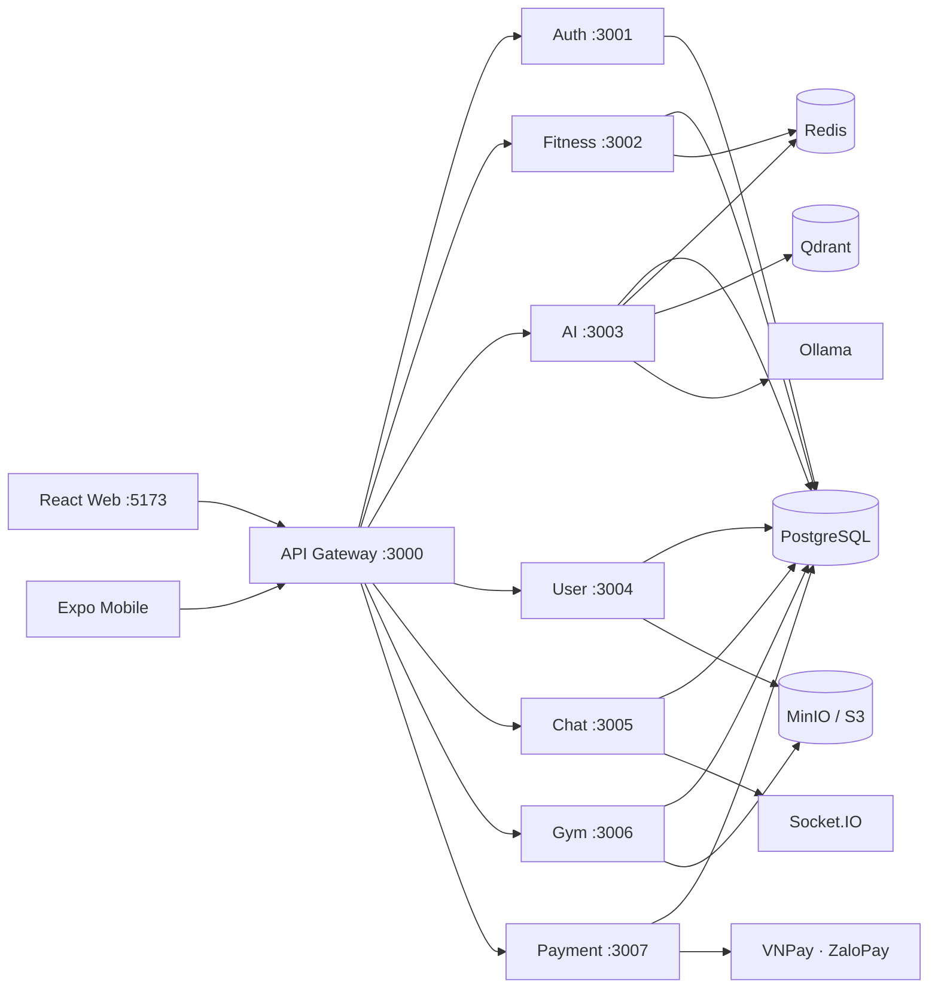

# Gymini — Fitness Assistant

> Nền tảng thể hình kết nối **khách tập – huấn luyện viên cá nhân (PT) – phòng gym**:
> lộ trình tập luyện và dinh dưỡng có AI hỗ trợ, theo dõi InBody, đặt buổi với PT,
> mua gói hội viên gym, check-in QR, ví và thanh toán VNPay/ZaloPay, chat và gọi video.

[](https://www.typescriptlang.org/)
[](https://react.dev/)
[](https://expo.dev/)
[](https://nodejs.org/)
[](https://www.postgresql.org/)
[](https://docs.docker.com/compose/)

Gymini là đồ án khoá luận, xây quanh các luồng nghiệp vụ thật thay vì một tập demo rời rạc.
Mỗi vai trò có không gian làm việc riêng trên web và ứng dụng di động, dùng chung một backend.

## Tính năng theo vai trò

| Vai trò | Làm được gì |
| --- | --- |
| **Khách tập** | Hồ sơ + chỉ số InBody (nhập tay hoặc quét ảnh), lộ trình dài hạn → giai đoạn → chu kỳ tập, lịch tập và ghi từng set, kế hoạch dinh dưỡng, AI Coach (chat có ngữ cảnh), tìm PT/gym, đặt buổi, mua gói hội viên, check-in QR, ví, khiếu nại |
| **PT** | Nộp hồ sơ đối tác, tin đăng + gói dịch vụ, lịch rảnh, hợp đồng và buổi tập với khách (tối đa 2 PT/khách, không trùng giờ), duyệt kế hoạch AI cho khách, check-in tại gym, ví PT và rút tiền |
| **Chủ gym** | Tự đăng ký đối tác, quản lý thương hiệu/chi nhánh, tiện ích, giờ mở cửa, gói hội viên, PT hợp tác, nhân sự **lễ tân** (quầy check-in, check-in hộ) và **kế toán** (tài chính, xuất CSV) |
| **Admin** | Duyệt PT/gym/tin đăng, quản lý người dùng, tài chính (đối soát, duyệt rút tiền bốn mắt từ 5.000.000 ₫, tra cứu ví), xử lý khiếu nại/tranh chấp và kháng nghị |

## Kiến trúc



- Mỗi service sở hữu **một database riêng** (Prisma), chạy chung một container PostgreSQL khi phát triển.
- Gateway là ranh giới duy nhất phía trình duyệt/app: xác thực JWT, phân quyền theo vai trò, rate limit.
- Gọi giữa các service qua route `/internal/*` có secret nội bộ.
- Tiền đi qua sổ cái ví hai ngăn + escrow ở `payment-service`; hợp đồng và buổi tập ở `user-service`; hội viên, chi nhánh, check-in ở `gym-service`.

## AI

Ứng dụng kết hợp **logic thể hình tất định** với RAG — LLM không phải nơi ra quyết định duy nhất.

- Chat model mặc định: `qwen3:4b-instruct-2507-q4_K_M` qua Ollama (đổi bằng `LLM_MODEL`)
- Embedding: `nomic-embed-text` (768 chiều), vector store Qdrant
- Ngữ cảnh: hồ sơ, InBody, lịch tập, dinh dưỡng, chu kỳ tập, trí nhớ hội thoại
- Rào chắn: kiểm schema, quy tắc an toàn, fallback tất định, kiểm định kế hoạch cuối, bài tập luôn gắn với danh mục `Exercise` thật
- Quét InBody bằng mô hình thị giác (Ollama cục bộ hoặc nhà cung cấp cấu hình qua `INBODY_VISION_PROVIDER`)
- Pipeline fine-tune (QLoRA) nằm riêng ở `training/`, không bắt buộc để chạy sản phẩm

## Công nghệ

| Tầng | Công nghệ |
| --- | --- |
| Web | React 18, Vite 6, TypeScript, Tailwind CSS, TanStack Query, Zustand |
| Mobile | Expo 57, React Native 0.86, Expo Router, NativeWind, Maestro (UI test) |
| Backend | Node.js 20, Express, TypeScript, Prisma 5, Zod, BullMQ, Socket.IO |
| Dữ liệu | PostgreSQL 15, Redis, Qdrant, MinIO (S3) |
| AI | Ollama, Qwen3 4B, `nomic-embed-text`, RAG |
| Thanh toán | VNPay, ZaloPay (sandbox); ví nội bộ, escrow, hoàn tiền, rút tiền |
| Hạ tầng | Docker Compose, Prometheus, Grafana; AWS (Lambda, ECS, Aurora, S3, CloudFront) cho môi trường dev |
| Kiểm thử | Unit/integration (DB `*_test` cô lập), Docker test stack, E2E khiếu nại cô lập, Maestro, Playwright (harness ngoài repo) |

## Chạy local

### Yêu cầu

- Node.js 20+, pnpm 8+
- Docker Desktop
- Ollama (cho tính năng AI)

### 1. Cài đặt

```powershell
Copy-Item .env.example .env
pnpm install
```

Xem lại `.env` trước khi chạy. Giá trị mặc định chỉ dành cho máy local; mọi secret thật phải tự đặt.

### 2. Bật Ollama

Compose gọi Ollama qua `host.docker.internal:11434`, nên Ollama phải nghe ngoài loopback:

```powershell
$env:OLLAMA_HOST = "0.0.0.0:11434"
ollama serve
ollama pull qwen3:4b-instruct-2507-q4_K_M
ollama pull nomic-embed-text
```

### 3. Bật hệ thống

```powershell
docker compose -f infra/compose/docker-compose.dev.yml up -d --build
docker compose -f infra/compose/docker-compose.dev.yml ps
```

- Web: `http://localhost:5173` · Health API: `http://localhost:3000/health`
- Lần đầu, `db-seeder` tạo tài khoản thử (ví dụ `testuser001@example.com`, `testpt001@example.com`, mật khẩu `Test@123456`).
  Từ lần sau nên đặt `SKIP_SEED=true` trong `.env` để seeder không nạp lại dữ liệu cũ.
- Đổi `.env` thì phải `up -d --force-recreate` service liên quan mới nhận.
- Dữ liệu demo quy mô lớn (10.000 PT, 2.500 gym, 25.000 khách): xem [scripts/seed-marketplace/official/README.md](scripts/seed-marketplace/official/README.md).

Profile tuỳ chọn: `local-ollama` (Ollama trong Docker), `knowledge` (worker nạp tri thức), `observability` (Prometheus/Grafana).
Máy yếu: thêm `-f infra/compose/docker-compose.low-resource.yml`.

### Ứng dụng di động

```powershell
cd frontend/mobile
pnpm start            # Expo dev server
```

Trên emulator Android dùng `adb reverse tcp:3000 tcp:3000` và đặt server URL là `http://localhost:3000`.

## Bản đồ cổng

| Thành phần | Cổng | Trách nhiệm |
| --- | ---: | --- |
| Web | 5173 | React client + Vite proxy |
| API Gateway | 3000 | Xác thực, định tuyến, rate limit |
| Auth Service | 3001 | Tài khoản, JWT, vai trò, nhật ký bảo mật |
| Fitness Service | 3002 | Bài tập, lộ trình, chu kỳ tập, lịch tập, dinh dưỡng |
| AI Service | 3003 | AI Coach, RAG, sinh kế hoạch |
| User Service | 3004 | Hồ sơ, InBody, PT, hợp đồng, buổi tập, khiếu nại, thông báo |
| Chat Service | 3005 | Hội thoại, tin nhắn realtime, gọi video |
| Gym Service | 3006 | Gym, chi nhánh, hội viên, check-in, nhân sự |
| Payment Service | 3007 | Ví, sổ cái, escrow, VNPay/ZaloPay, rút tiền, đối soát |
| PostgreSQL | 5433 | Database dev |
| Redis | 6379 | Cache, hàng đợi |
| Qdrant | 6333 | Vector search |
| MinIO | 9000 | Lưu ảnh/tài liệu (S3) |
| Prometheus / Grafana | 9090 / 3100 | Giám sát (profile `observability`) |

## Kiểm thử

```powershell
pnpm run lint
pnpm run build
pnpm test
pnpm docker:test:fast      # test trong Docker, DB cô lập
pnpm docker:test:full      # đầy đủ hạ tầng
```

Test có DB luôn chạy trên database `*_test` riêng — không bao giờ đụng DB dev. Chi tiết: [docker/test/README.md](docker/test/README.md).

## Cấu trúc thư mục

```text
backend/gateway/          API gateway
backend/services/         7 microservice (auth, user, fitness, ai, chat, gym, payment)
backend/shared/           Tiện ích TypeScript dùng chung
frontend/web/             Ứng dụng web React
frontend/mobile/          Ứng dụng di động Expo (bản mobile duy nhất)
infra/compose/            Docker Compose dev / test / e2e / prod
infra/terraform/, infra/cloudformation/   Hạ tầng AWS
infra/monitoring/         Prometheus, Grafana
scripts/                  Seed, dọn dữ liệu, E2E, công cụ CI
data/                     Danh mục bài tập/thực phẩm, dữ liệu RAG, bộ đánh giá
training/                 Pipeline fine-tune mô hình (tuỳ chọn)
tools/db-migrator/        Công cụ chuyển dữ liệu
```

## Tài liệu

- [`docs/README.md`](docs/README.md) — mục lục toàn bộ tài liệu.
- [`docs/HANDBOOK.md`](docs/HANDBOOK.md) — sổ tay chính: luật nghiệp vụ, kiến trúc & vận hành, việc còn mở.
- README của từng thành phần nằm cạnh mã: `docker/test/`, `scripts/seed-marketplace/`, `scripts/db-clean/`, `scripts/e2e-dispute/`, `tools/db-migrator/`, `training/`, `infra/terraform/`.

## An toàn và phạm vi

Gymini đưa ra hướng dẫn thể hình mang tính giáo dục, **không phải hệ thống chẩn đoán y khoa**.
Lớp AI được thiết kế để không bịa trích dẫn, không khuyên giảm cân cấp tốc nguy hiểm, không khuyên tập khi đang chấn thương.
Không commit dữ liệu cá nhân/y tế thật vào repo hay vào bộ dữ liệu huấn luyện.

## Trạng thái

Đồ án khoá luận đang phát triển tích cực. Các luồng chính trên web, mobile và backend đã chạy được end-to-end
trên môi trường dev; cổng thanh toán dùng sandbox; chưa phải bản production.
