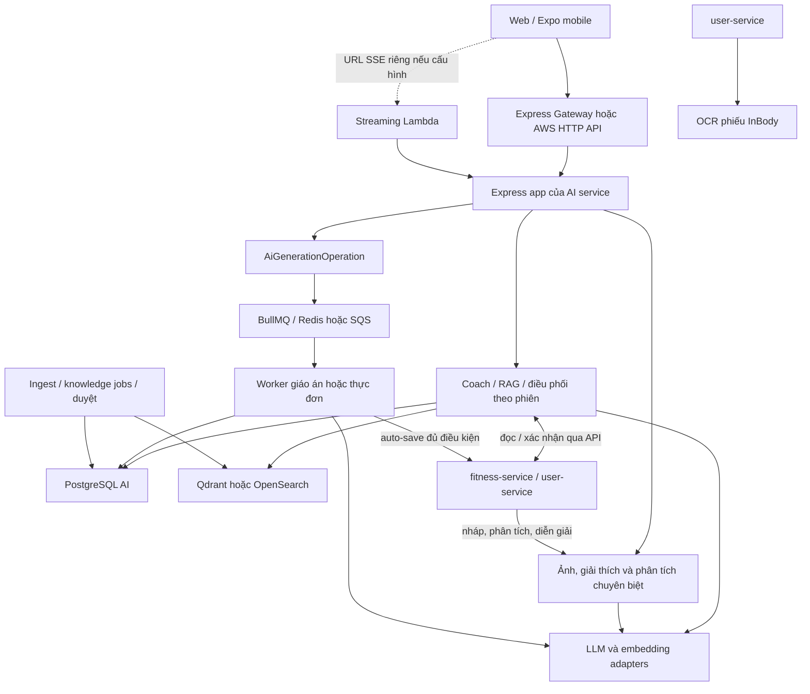
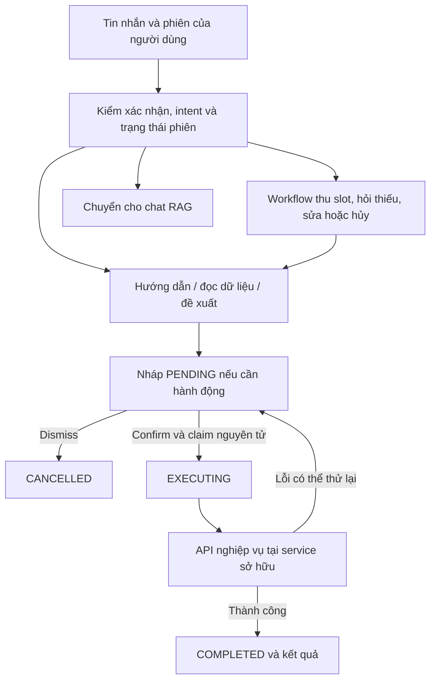
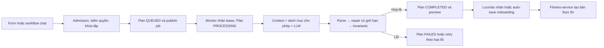
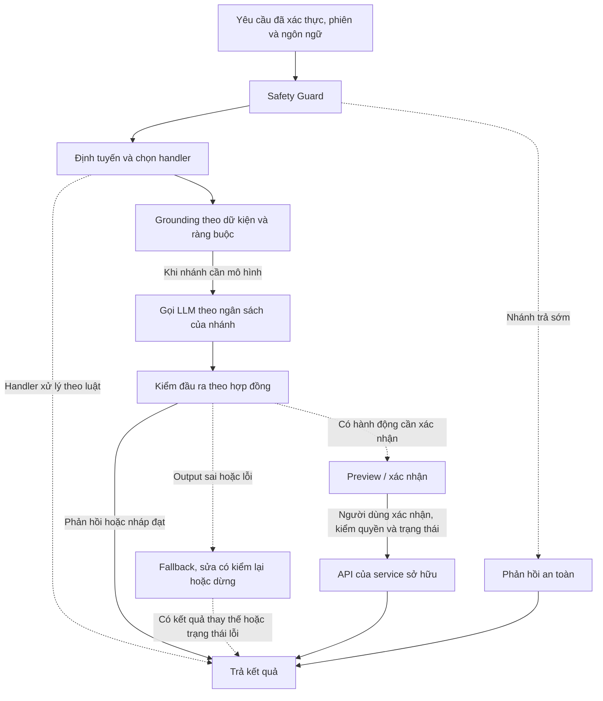

# Kiểm toán kiến trúc và luồng AI Gymini V1

Tài liệu kỹ thuật phục vụ khóa luận tốt nghiệp · Ngày kiểm toán 19/11/2026

**Mốc phân tích** `v1.0.0-rc2` · `4cde78f7d1d26347fe0de1d8787f0217e81b42ab`

**Mức bằng chứng chính** `CODE AUDIT` · Phạm vi kiểm thử tại §12.

[Kiến trúc](#2-kiến-trúc-thực-thi) · [Chat](#3-ai-coach-và-hợp-đồng-chat) · [Workflow](#4-điều-phối-workflow-và-xác-nhận) · [RAG](#5-rag-và-đường-nạp-dữ-liệu) · [Sinh kế hoạch](#7-sinh-giáo-án-thực-đơn-và-lưu-chương-trình) · [Ảnh và InBody](#8-ảnh-và-inbody) · [Runtime Harness](#111-runtime-harness-trong-luồng-ai) · [Đánh giá](#112-bộ-kiểm-thử-và-đánh-giá) · [Kết quả test](#12-kết-quả-kiểm-tra-trong-đợt-này) · [Danh mục API](#14-danh-mục-điểm-vào-và-ví-dụ-truy-vết).

## 1. Phạm vi và phiên bản

Gymini V1 điều phối AI bằng **luật nghiệp vụ, dữ liệu người dùng, truy xuất tri thức và mô hình sinh**. Một lượt chat có thể kết thúc bằng câu trả lời theo luật, đọc dữ liệu thực, đặt câu hỏi bổ sung, tạo đề xuất hoặc gọi mô hình để diễn đạt. Giáo án và thực đơn nhiều ngày có hàng đợi riêng. Ảnh InBody, ảnh mục tiêu, diễn giải chỉ số và hỗ trợ PT đi qua các điểm vào chuyên biệt.

| Mốc | Bằng chứng và cách sử dụng |
| --- | --- |
| `v1.0.0-rc1` → `3cab8b216fae9e5f9fffb19ce535fcb7c4f5d58d` | Ứng viên phát hành trước đó. |
| `v1.0.0-rc2` → `4cde78f7d1d26347fe0de1d8787f0217e81b42ab` | Tag V1 mới nhất thấy trong Git local. So với RC1, diff AI service gồm chuẩn hóa văn bản cho phân loại an toàn, sử dụng chuẩn hóa trong orchestrator và test so sánh tiếng Việt có dấu, không dấu và Unicode tổ hợp. Đây là snapshot nguồn chính của báo cáo. |
| `aws-deploy` tại `3079ed5ffa3b599a3ec3b282990f623fc5604f63` | RC2 là tổ tiên của HEAD. Các phần thay đổi sau RC2 và phần chưa commit được ghi ở §13. |
| RC3 và nhánh `feature/ai-v2-agent` | Repo local có gói chuẩn bị RC3 và nhánh phát triển AI Agent V2 riêng. Git local hiện hai tag RC1/RC2. `CI-V2` và `RAG_RETRIEVAL_V2` là tên tính năng đã có trong nguồn RC2 của V1. |

Phạm vi gồm các route AI gắn vào HTTP app, nhánh xử lý của Coach, processor và pipeline dữ liệu, caller liên dịch vụ, đường client, cùng mã kiểm thử, đánh giá và nghiên cứu. Các chức năng marketplace thuần nghiệp vụ xuất hiện ở những điểm chúng cấp dữ liệu, xác nhận hoặc tiêu thụ kết quả AI. Mã trong tag được đọc từ bản trích xuất `git archive`. Liên kết tương đối đưa tới file trong workspace. Tên hàm và đường dẫn dùng để tra lại phiên bản chính xác qua `git show`. Báo cáo phát hành cũ là chứng cứ lịch sử. Trạng thái AWS và cấu hình runtime chưa được đối chiếu trực tiếp. [Ghi chép phát hành RC2](release/v1.0.0-rc2/RC2-PREP-vi.md) · [Gói chuẩn bị RC3](release/v1.0.0-rc3/RC3-PREP-vi.md).

## 2. Kiến trúc thực thi



| Thành phần | Đường chạy và vai trò |
| --- | --- |
| Local / container | Client gọi Express Gateway. Gateway proxy các nhóm route và có route SSE riêng. AI service chạy `server.ts`, khởi tạo worker BullMQ. Knowledge worker có entry point riêng. |
| AWS | HTTP Lambda dùng `serverless-http` sau bootstrap DB và runtime config. `stream-lambda.ts` chuyển tiếp sang Express qua HTTP nội bộ trong Lambda để stream response ở Function URL. Web/mobile chọn URL qua cấu hình. Với giao vận dạng buffer, frontend có thể nhận cả gói SSE một lượt. |
| Async | `queue-provider.ts` gửi tác vụ qua BullMQ hoặc qua SQS khi `QUEUE_PROVIDER=sqs`. `worker-lambda.ts` xử lý SQS. `jobs-lambda.ts` có tác vụ tri thức, thu hồi generation bị treo và sweep marketplace. |
| Xác thực | `requireAuth` tạo `req.context` từ JWT kiểm chứng qua auth-service hoặc định danh service/gateway đã xác thực. Route phân tích nghiệp vụ dùng thêm `requireTrustedService`. Caller gateway mang Bearer của người dùng thuộc loại `gateway_user`. Route admin kiểm vai trò. |
| Quota | AI service mặc định giới hạn mỗi 60 giây 20 lượt chat, 10 lượt đắt và 30 lượt nội bộ theo user đã xác thực. Nhánh gửi generation kiểm quota tại admission. Gateway có hạn mức chat riêng. |
| Provider | `llm.service.ts` gồm Ollama, Anthropic API, Bedrock, mock và nhánh endpoint tương thích OpenAI tại `LLM_BASE_URL`. Embedding cấu hình riêng, mặc định Ollama hoặc mock nếu LLM là mock. Cohere Embed v3 trên Bedrock dùng 1024 chiều. Ollama/mock mặc định 768. Vector adapter mặc định Qdrant và có lựa chọn OpenSearch. Đọc, ghi và khởi tạo index phụ thuộc cấu hình chiều vector. |

Nguồn mã [Gateway proxy](../backend/gateway/src/routes/proxy.routes.ts) · [Express app](../backend/services/ai-service/src/app.ts) · [server](../backend/services/ai-service/src/server.ts) · [HTTP Lambda](../backend/services/ai-service/src/lambda.ts) · [stream Lambda](../backend/services/ai-service/src/stream-lambda.ts) · [worker Lambda](../backend/services/ai-service/src/worker-lambda.ts) · [jobs Lambda](../backend/services/ai-service/src/jobs-lambda.ts) · [auth](../backend/services/ai-service/src/middleware/auth.middleware.ts) · [trusted service](../backend/services/ai-service/src/middleware/require-trusted-service.middleware.ts) · [rate limit](../backend/services/ai-service/src/middleware/ai-rate-limiters.ts) · [LLM service](../backend/services/ai-service/src/services/llm.service.ts) · [embedding config](../backend/services/ai-service/src/services/embedding-config.ts) · [vector provider](../backend/services/ai-service/src/vector-store/provider.ts).

## 3. AI Coach và hợp đồng chat

**Đầu vào.** `POST /ai/ask` hoặc `POST /ai/ask/stream` nhận `question` từ 1 đến 2.000 ký tự, `sessionId` UUID tùy chọn và `clientRequestId` tùy chọn. Nếu mã yêu cầu hợp lệ, RAG service tra theo cặp user và mã yêu cầu. Nếu lượt đã lưu, service trả lại nội dung cũ. Nếu câu hỏi hoặc phiên xung đột, service từ chối tái sử dụng mã đó. Hai lượt đến cùng lúc có thể cùng chạy trước khi một hàng thắng ở ràng buộc unique. Cơ chế này bảo vệ số bản ghi hội thoại. Số lần suy luận và tác động trước lúc lưu cần được kiểm chứng riêng.

**Phiên.** Có `sessionId` thì kiểm tra chủ sở hữu và archive trước khi chạy. Thiếu `sessionId` thì tạo phiên với tiêu đề từ câu hỏi. Lịch sử theo user và phiên lấy tối đa năm lượt đủ điều kiện trong đường prompt. Route session cung cấp danh sách, tin nhắn, đổi tên và archive. `Conversation` ghi câu hỏi, câu trả lời, trạng thái fallback, intent, ID trace, nhãn model và các trường token mà đường trả lời cung cấp.

| Bước | Nhánh thực thi | Đầu ra hoặc cách suy giảm |
| --- | --- | --- |
| 1 | `runInner` nhận diện ngôn ngữ, tạo trace, chạy `safetyGuard` và kiểm tuổi hồ sơ khi phù hợp. Khởi chạy phân loại ứng viên memory ở nền. | Câu ngoài phạm vi, cấp cứu, chẩn đoán và các nguy cơ dinh dưỡng có thể kết thúc bằng nội dung định sẵn. |
| 2 | Xét câu hỏi về trợ lý, yêu cầu liên quan dữ liệu người khác, yêu cầu tính macro cả ngày. | Nhánh meta trả lời trực tiếp. Hỏi chung về học viên tách ngữ cảnh của PT. PT Copilot có đường riêng. Macro cả ngày trả block dữ liệu. |
| 3 | `fitnessAgent.tryTurn` kiểm phiên, xác nhận, hướng dẫn, workflow và intent nghiệp vụ. | Nếu handler trả `null`, tiếp tục đường chat. Xem §4. |
| 4 | `Promise.all` lấy context hồ sơ, retrieval, lịch sử và memory. Kiểm intent tra lịch ăn/tập để bỏ qua retrieval khi phù hợp. | Timeout hồ sơ tạo context rỗng. Lỗi retrieval bỏ qua tài liệu. Lỗi đọc memory dùng danh sách rỗng. Tra lịch có đường phân biệt thiếu dữ liệu và downstream lỗi. |
| 5 | Giải quyết dữ kiện lượt hiện tại, intent, mục tiêu dinh dưỡng, lịch tập/ăn và thể trạng. Chọn memory, lập `context_plan`, tính/gợi ý theo luật hoặc nhận diện nhu cầu gọi mô hình. | Một số câu được trả lời từ lịch, mục tiêu, phép tính hoặc mẫu. Câu giả định và so sánh dùng dữ kiện của lượt. Context cá nhân hóa được giới hạn theo intent. |
| 6 | `promptBuilder` ghép prompt theo intent và ngân sách context, thêm đoạn truy xuất/evidence, quy tắc claim và dữ kiện được phép. | Gọi `callLLM` hoặc đường tool calling nếu được cấu hình. Lỗi hoặc kết quả rỗng có thể chuyển sang fallback. |
| 7 | Chuẩn hóa tên bài tập và ngôn ngữ, lọc lỗi trình bày, kiểm ràng buộc số liệu, claim BMI, intake, hồ sơ, thiết bị và safety. | `answerValidator` ghi cảnh báo và có thể dùng câu trả lời tất định khi sai cấu trúc hoặc số liệu quan trọng. Handler trả sớm dùng hợp đồng hoặc kiểm tra riêng. |
| 8 | `ragService` lưu lượt, cập nhật thời điểm tin nhắn cuối ở nền, trả payload. `ENABLE_LLM_SELF_EVAL=true` mở thêm một lượt đánh giá relevance. | Self-eval là tín hiệu do model sinh, có thể trả `UNKNOWN`. JSON có đường 503 khi lỗi LLM đi tới controller. SSE gửi sự kiện lỗi. |

**SSE trên giao diện.** Hai API dùng cùng `ragService.rag`. Streaming gửi `status`, heartbeat khi pacing hoạt động, `token`, rồi `done` hoặc `error`. `askStream` đợi kết quả đầy đủ, sau đó gửi từng đoạn văn bản để tạo hiệu ứng gõ. `done` chứa ID phiên, ID lượt và metadata để render block trên web/mobile. Đây là truyền theo luồng ở lớp giao vận và UI. Pacing ảnh hưởng tới thời điểm hiện chữ, nên phép đo TTFT cần ghi rõ nó đo ở tầng nào.

**Dữ liệu dinh dưỡng.** Nhánh hỏi lịch ăn đọc dữ liệu cho ngày được yêu cầu. Nhánh tính toán phân biệt nhật ký, mục tiêu lưu và phép ước tính, xử lý xung đột cân nặng theo nguồn. `nutrition_engine` có phép kiểm năng lượng macro theo hệ số 4/4/9 và ước tính BMR/TDEE từ Mifflin–St Jeor cùng mức hoạt động khi đủ dữ liệu. Khoảng TDEE trong code là dải heuristic. `NutritionGoal` là nguồn chỉ tiêu đã lưu. `day-macro-estimate` có parser model kèm fallback, tra món và chuẩn hóa đơn vị, tính tổng từ dữ liệu món, báo mục chưa xác định và hỗ trợ thao tác lưu riêng.

Nguồn mã [schema chat](../backend/services/ai-service/src/schemas/ai.schemas.ts) · [route](../backend/services/ai-service/src/routes/ai.routes.ts) · [controller và SSE](../backend/services/ai-service/src/controllers/ai.controller.ts) · [RAG service](../backend/services/ai-service/src/services/rag.service.ts) · [orchestrator](../backend/services/ai-service/src/llm/orchestrator.service.ts) · [prompt](../backend/services/ai-service/src/llm/prompt_builder.ts) · [context plan](../backend/services/ai-service/src/llm/context_plan.ts) · [validator](../backend/services/ai-service/src/llm/answer_validator.ts) · [nutrition engine](../backend/services/ai-service/src/llm/nutrition_engine.ts) · [macro cả ngày](../backend/services/ai-service/src/services/day-macro-estimate.ts) · [AI Coach web](../frontend/web/src/app/pages/client/AICoachPage.tsx) · [Coach store mobile](../frontend/mobile/src/features/coach/coachStore.ts).

## 4. Điều phối workflow và xác nhận

V1 có hai lớp điều phối trong đường chat. `llmOrchestrator` kiểm biên và điều phối câu trả lời. `fitnessAgent` xử lý hành động trong phiên đã kiểm tra quyền, bằng các handler hữu hạn đã lập trình. Các nhãn “agent” trong trace global router mô tả vai trò xử lý của module.



- `AgentWorkflowSession` lưu tiến độ và slot theo user/phiên. Các workflow đăng ký gồm tìm PT/chương trình, tạo lịch tập, tạo thực đơn, tạo lộ trình và cập nhật mục tiêu. Workflow đang chờ xử lý tiếp các lượt như “72 kg”. Có đường hỏi lại, xác nhận sửa dữ kiện hồ sơ hoặc dùng một lần ở nơi được phép. Khi đủ dữ liệu, `RESUME_SENTINEL` chuyển về intent của workflow đang chạy.
- `CONVERSATIONAL_INTELLIGENCE_V2` có `off`, `shadow`, `on`, mặc định mã là `off`. Khi bật, global router phân nhóm đọc trạng thái, gợi ý, kiến thức, đề xuất thay đổi và câu đa ý. `CONVERSATIONAL_INTELLIGENCE_V2_LLM` mở diễn giải/định tuyến semantic trong các nhánh đủ điều kiện. Các model call ở RAG QA, tạo kế hoạch, ảnh và diễn giải có đường riêng.
- `GYMINI_UNIFIED_AI_COACH=on` cho phép bounded executor xử lý một số lượt kết hợp đọc và gợi ý PT/chương trình, bên trong đường global của CI. Planner đặt trần hai lượt đọc, một gợi ý, không có thao tác đề xuất ghi trong executor. Các lượt khác tiếp tục qua composer có sẵn. Turn-understanding adapter tạo biểu diễn và log phục vụ phân tích.
- `FitnessRecommendation` lưu danh sách đề xuất theo chủ sở hữu và phiên. Với thao tác có thẻ xác nhận, UI chọn ứng viên, hiển thị preview, gọi `POST /ai/agent/actions/:id/confirm` với `confirmed: true` hoặc gọi `/dismiss`. Backend kiểm quyền, phiên, trạng thái và hạn dùng. Confirm/dismiss cạnh tranh bằng update có điều kiện. Có phát lại kết quả đã hoàn tất và đường reclaim action đang thực thi bị treo. Việc chống lặp ở service đích tùy từng hành động.
- Xác nhận bằng tin nhắn có cơ chế riêng. `tryConfirmationBoundary` đọc trạng thái thật và hướng tới thẻ xác nhận khi action yêu cầu. Workflow cập nhật hồ sơ có `handleSlotConfirmation`. Xác nhận ảnh mục tiêu có endpoint riêng.

| Luồng chat | Xử lý và tác dụng trong code |
| --- | --- |
| Hỏi trạng thái, hướng dẫn tập | Reader đọc hồ sơ, mục tiêu, chương trình, buổi đã đặt, lịch sử hoặc đề xuất hiện hành. Hướng dẫn buổi đầu/tiếp theo, kỹ thuật bài tập và người mới có handler riêng. |
| Tìm PT | Thu mục tiêu, lịch, ngân sách và ràng buộc. Lấy ứng viên từ user-service, lọc/xếp hạng, ghi recommendation và dựng thẻ. Chọn PT/gói sinh action tạo nháp. Xác nhận lần đầu tạo nháp hợp đồng và action xác nhận tiếp. Xác nhận sau gửi yêu cầu hợp đồng. PT duyệt và thanh toán là các bước riêng của ứng dụng. |
| Chọn chương trình có sẵn | Thu yêu cầu, lấy template/candidate, lọc và chấm điểm theo luật. Narrator model nếu dùng diễn giải từ danh sách đã chấm, có guard claim và fallback tất định. Chọn ứng viên sinh `APPLY_TRAINING_PLAN`. Xác nhận gọi fitness-service áp dụng template. |
| Tạo giáo án / thực đơn trong chat | Thu slot → xếp job → theo dõi trạng thái → thẻ preview → lưu khi xác nhận. Sửa nháp xử lý số buổi/ngày, nhóm cơ, thời lượng, bài tập hoặc ràng buộc bữa/món. Có sửa tất định, xếp job lại và hỏi mục tiêu sửa khi mơ hồ. |
| Đổi bài tập | Đề xuất bài thay thế theo catalog/thiết bị. Với bài đã lưu, tìm bài mục tiêu và ID thay thế, hiển thị preview, rồi cập nhật chương trình qua fitness-service khi xác nhận. |
| Cập nhật mục tiêu | Đọc hồ sơ, thu mục tiêu/cân nặng đích và áp chính sách an toàn. Xác nhận dữ kiện thay đổi có kiểm lại giá trị hiện tại trước khi gọi user-service. |
| Gói lộ trình + tập + dinh dưỡng | `CREATE_PLAN_BUNDLE` chuẩn bị roadmap draft, phương án chương trình và bootstrap mục tiêu dinh dưỡng. Khi xác nhận, gọi các bước riêng và lưu `bundleProgress`. Ba bước có thể thành công từng phần, với đường thử lại phần lỗi. |
| Lộ trình, chu kỳ, lịch buổi | Đọc tiến độ hoặc chuẩn bị chuyển/tạo lại/lưu trữ lộ trình, kết thúc/hủy chu kỳ, bắt đầu/bỏ qua/hủy buổi tập. Handler action gọi API fitness và trả kết quả. Có nhánh đánh giá chu kỳ và xem/duyệt đề xuất tập/dinh dưỡng. |
| Ghi bữa và phân tích món | Parser tách món/lượng, tra thực phẩm. Câu hỏi tính hoặc thêm món để phân tích có đường đọc. `NUTRITION_LOG_MEAL` ghi bữa khi xác nhận. Ước tính cả ngày có giao diện lưu riêng. |
| PT Copilot | Đọc roster và tín hiệu tuân thủ theo thời gian, chọn học viên hoặc hỏi nếu mơ hồ. Dựng đề xuất kèm dữ kiện. Duyệt/bỏ qua gọi fitness-service ghi audit sau khi kiểm quan hệ PT–client. Duyệt trả nội dung gợi ý để PT sử dụng. |

Luật chọn ứng viên và API nghiệp vụ xác định đối tượng, điều kiện và kết quả. Nhánh tìm PT chấm theo mục tiêu/lịch/ngân sách/uy tín/evidence với trọng số 30/25/20/10/15. Khi cohort nhỏ hơn ngưỡng của code, bỏ thành phần evidence khỏi mẫu số. Nhánh chương trình chấm `program-compatibility-v2` sau lọc đủ điều kiện, với trọng số 70/20/10 cho thời lượng buổi, cơ trọng tâm và số tuần nếu có dữ kiện. Hai nhánh sắp theo điểm, xử lý hòa bằng ID và lấy tối đa năm mục trong đường `buildAndPersistRecommendation`. Điểm là độ khớp theo heuristic. Narrator diễn đạt từ ứng viên và dữ kiện. Các block có kiểu như `ACTION_CONFIRMATION`, `ACTION_RESULT`, `WORKOUT_PLAN_PREVIEW` và `NUTRITION_PLAN_PREVIEW` dùng chung giữa backend và client. [Scoring PT và chương trình](../backend/shared/src/fitness-agent-scoring.ts) · [Claim catalog cho PT](../backend/services/ai-service/src/llm/recommendation_claims.ts) · [Claim catalog cho chương trình](../backend/services/ai-service/src/llm/program_recommendation_claims.ts).

Nguồn mã [fitness agent và execute](../backend/services/ai-service/src/services/fitness-agent.service.ts) · [tools nghiệp vụ](../backend/services/ai-service/src/services/fitness-agent-tools.ts) · [workflow state machine](../backend/services/ai-service/src/agent-workflow/orchestrator.ts) · [CI flags](../backend/services/ai-service/src/conversational-intelligence/index.ts) · [global turn](../backend/services/ai-service/src/conversational-intelligence/global/global-turn.ts) · [bounded planner](../backend/services/ai-service/src/services/bounded-turn/planner.ts) · [bounded executor](../backend/services/ai-service/src/services/bounded-turn/executor.ts) · [biên xác nhận](../backend/services/ai-service/src/services/confirmation-boundary.ts) · [agent routes](../backend/services/ai-service/src/routes/fitness-agent.routes.ts).

## 5. RAG và đường nạp dữ liệu

### 5.1. Luồng đọc trong request

1. `retriever.retrieveForChat` chuẩn bị truy vấn, có mở rộng từ khóa cho một số chủ đề và nhận diện ràng buộc. Truy vấn được nhúng với `search_query`. Adapter tìm kiếm theo index và ánh xạ payload thành đoạn tài liệu với nguồn/metadata. `RAG_TOP_K` mặc định 5 và `RAG_MIN_SCORE` mặc định 0,35 trong retriever.
2. Đường chat mặc định dùng `exercises`, `fitness_knowledge`, `fitness_faq`, `fitness_evidence`, có xếp hạng theo loại nguồn. FAQ tổng hợp được đánh dấu và giới hạn đóng góp. Một lần tìm kiếm riêng qua `retrieveEvidence` phục vụ các nhánh cần bằng chứng như đánh giá và dựng kế hoạch, giới hạn vào `fitness_evidence`. Dữ liệu nghiệp vụ của người dùng được truy cập bằng reader/API, theo các đường riêng.
3. `RAG_RETRIEVAL_V2=on` chọn retrieval có nhận diện miền, luật phạm vi, sàng lọc ý định ngoài phạm vi, xếp hạng theo lớp nguồn và khử trùng. Nó xử lý xung đột khoảng số theo ngữ cảnh hoặc đánh dấu chưa đủ ngữ cảnh. Khi phát hiện tín hiệu an toàn, nguồn phù hợp được giới hạn theo điều kiện của pipeline và có thể trả tập rỗng. Lựa chọn mặc định trong code là `off`. `rag-gate.ts` được dùng để đánh giá ngưỡng từ metrics qua runner của retrieval.
4. `prompt_builder` thu gọn đoạn và metadata, ghép với context của lượt. Câu trả lời có thể trả metadata `evidenceUsed`. Một đoạn được đưa vào prompt cho thấy hệ thống đã cấp ngữ cảnh. Mức độ câu trả lời được đoạn đó hậu thuẫn cần chấm trên từng claim. Vector index lỗi hoặc không có kết quả có thể đưa luồng về context rỗng, luật hoặc fallback, tùy intent.

Nguồn mã [retriever](../backend/services/ai-service/src/llm/retriever.ts) · [xếp hạng theo nguồn](../backend/services/ai-service/src/llm/retrieval_ranking.ts) · [retrieval tùy chọn](../backend/services/ai-service/src/llm/retrieval-v2.ts) · [RAG gate](../backend/services/ai-service/src/llm/rag-gate.ts) · [an toàn retrieval](../backend/services/ai-service/src/llm/safety-signals.ts) · [runtime classifier nhỏ](../backend/services/ai-service/src/llm/query-classifiers/classifier-runtime.ts).

### 5.2. Luồng nhập dữ liệu và vận hành kho tri thức

| Đường | Dữ liệu, xử lý và đích |
| --- | --- |
| Seed RAG từ CSV | `ingest.ts` đọc CSV bài tập, nội dung tri thức và FAQ theo cấu hình, kiểm cột, tạo payload/text, embed tài liệu, bảo đảm index đúng chiều và upsert. Chọn collection hoặc kiểm đã có dữ liệu qua tham số CLI. Các ID nội bộ trong vector payload phục vụ retrieval. |
| Ingest bằng chứng | `knowledge-pipeline/service.ts` nhận tài liệu local JSONL, PubMed, RSS hoặc web theo registry. Ghi pipeline run, chặn trùng, chấm trust/chất lượng, kiểm an toàn theo luật và model judge nếu bật. Phân luồng reject/review/accept. Có bước so trùng semantic khi embed, chia chunk, lưu metadata rồi upsert evidence và cập nhật trạng thái. |
| Duyệt thủ công | Route admin hoặc nội bộ cho xem/chấp thuận/từ chối hàng review. Các lựa chọn nguồn và bước duyệt tạo lịch sử trong Postgres. Vector store chứa corpus phục vụ đọc, các model `KnowledgeSource`, `KnowledgeDocument`, `KnowledgeChunk`, `KnowledgePipelineRun`, `KnowledgeReviewItem` quản lý provenance và trạng thái. |
| Tác vụ nền | Có đường chạy đồng bộ, enqueue BullMQ và lịch lặp cho knowledge worker. `jobs-lambda.ts` có dispatch cho các nhóm refresh trong nhánh AWS. Việc cấu hình lịch, worker và dữ liệu thực tế cần bằng chứng môi trường. |
| Research và catalog offline | `knowledge/` có CLI khám phá nguồn, chuẩn hóa, khử trùng và review JSONL, gồm bộ kết nối Crossref/OpenAlex. Chunker/indexer cũ được đánh dấu deprecated. `datasets/` có các bộ nhập bài tập, thực phẩm, NHANES và evidence. Mỗi script có điểm vào riêng. Cần manifest để xác định dữ liệu đã index hoặc dùng để train model đang chạy. |

Nguồn mã [CSV ingest](../backend/services/ai-service/src/ingest.ts) · [knowledge service](../backend/services/ai-service/src/knowledge-pipeline/service.ts) · [chunking](../backend/services/ai-service/src/knowledge-pipeline/chunking.ts) · [vector writer](../backend/services/ai-service/src/knowledge-pipeline/qdrant-writer.ts) · [worker và lịch](../backend/services/ai-service/src/knowledge-pipeline/queue.ts) · [internal routes](../backend/services/ai-service/src/routes/internal.routes.ts) · [research pipeline](../backend/services/ai-service/src/knowledge/README.md) · [script inventory](../backend/services/ai-service/package.json).

## 6. Context, memory và kiểm soát đầu ra

- **Hồ sơ và dữ liệu theo lượt.** `profileExtractor` kết hợp API user/fitness, cache theo user và gộp fetch đồng thời. Các enterprise reader/context assembler đọc riêng trạng thái tập, ăn, hồ sơ và mục tiêu theo nhu cầu. `TurnFacts` lọc dữ kiện mà người dùng vừa nêu. Resolver cân nặng có thể ưu tiên thông tin của lượt, đồng thời nêu xung đột với số đo lưu. Dữ kiện dùng một lần thay đổi ngữ cảnh của lượt.
- **Lịch sử và memory.** Lịch sử hội thoại theo phiên cung cấp các lượt gần đây. `UserMemory` dùng cho sở thích/thói quen bền vững phù hợp chính sách. `memory_extraction` lấy câu khai báo gốc trong tin nhắn của user, chạy policy, loại câu hỏi, giả định, dữ liệu nghiệp vụ có thể thay đổi và trường hợp mơ hồ. Có tác vụ ghi nền. `memory_selection` kiểm lại bản ghi cũ, cách ly bản không phù hợp khỏi prompt và chọn mục theo intent. Endpoint memory cho user xem/xóa của mình.
- **Tool calling của LLM.** `ENABLE_TOOL_CALLING=true` chọn `runToolCallingTurn` ở nhánh sinh chat. Lớp `callLLMChat` hỗ trợ Ollama. Danh sách model được phép gọi gồm `search_exercise_library` và `get_user_fitness_data`, tối đa hai tool call ở một lượt. `remember_user_fact` còn trong dispatcher phục vụ đường gọi trực tiếp/kiểm thử. Tools nghiệp vụ của `fitnessAgent` là API adapter có mã điều phối riêng.
- **An toàn.** Có phân loại đầu vào, xử lý tiếng Việt theo dạng chuẩn hóa ở RC2, kiểm tuổi, bảo vệ ngữ cảnh người khác và ràng buộc theo nhánh. Locale/formatters kiểm lời đáp. Bộ guard dành cho nhận định về số liệu, chương trình, khẩu phần và nguồn chỉ hỗ trợ các quy tắc được triển khai. RAG hoặc model có thể suy giảm, do đó trace và dữ kiện nguồn cần đi cùng đánh giá chất lượng.

Nguồn mã [profile extractor](../backend/services/ai-service/src/llm/profile_extractor.ts) · [context assembler](../backend/services/ai-service/src/services/context-assembler.ts) · [turn facts](../backend/services/ai-service/src/llm/turn_facts.ts) · [memory extraction](../backend/services/ai-service/src/llm/memory_extraction.ts) · [memory policy](../backend/services/ai-service/src/llm/memory_policy.ts) · [memory selection](../backend/services/ai-service/src/llm/memory_selection.ts) · [tools LLM](../backend/services/ai-service/src/llm/tools.ts) · [safety guard](../backend/services/ai-service/src/llm/safety_guard.ts).

## 7. Sinh giáo án, thực đơn và lưu chương trình

### 7.1. Đường đồng bộ và đường tác vụ

`POST /ai/generate-workout` là API đồng bộ cho đề xuất buổi tập ngắn theo goal, thời lượng, thiết bị và nhóm cơ. `conversationService.generateWorkout` tạo prompt, gọi LLM, phân tích mảng bài theo schema và trả lỗi nếu đầu ra sai. API này trả danh sách bài trong response. Giáo án nhiều tuần có quy trình tác vụ, ground ID và import ở phía fitness-service.

`POST /plans/workout/generate`, `POST /plans/nutrition/generate`, `POST /plans/adjust` và `POST /plans/nutrition/:planId/adjust` là đường trực tiếp. Chat cũng gọi cơ chế queue qua handler. Nhánh generate trả `202` cùng `planId`, `jobId`, `QUEUED`. Client xem trạng thái qua `GET /plans/job/:jobId`. Nháp chat theo dõi status và hiển thị block preview khi có kết quả, theo user và phiên.



`AiGenerationOperation` có trạng thái `RESERVING → ADMITTED → PUBLISHED → RUNNING → COMPLETED/FAILED`. Nó gắn actor/subject, kind, idempotency key, fingerprint, target, epoch và lease. Cùng khóa với dữ liệu khác trả xung đột. Worker claim trước khi chạy, chặn lần thực thi cũ ghi kết quả qua kiểm lease/target. Có recovery publish lại, xử lý operation treo hoặc hoàn tất terminal state, cùng replay auto-save có hạn. Bản ghi generation là theo dõi vận hành, còn `WorkoutPlan`/`NutritionPlan` là sản phẩm đã sinh ở AI service. Publish và lời gọi liên dịch vụ có cửa sổ lỗi riêng, được xử lý bằng replay/đối chiếu tùy nhánh.

### 7.2. Workout

1. Controller đọc goal, số tuần, buổi/tuần, bài/buổi, nơi tập và thiết bị. Có `contractId` thì xác minh hợp đồng ACTIVE của client qua user-service. Worker lấy thêm hồ sơ và bối cảnh nghiệp vụ.
2. `ai.worker.ts` dựng cấu trúc buổi tập và danh mục ứng viên từ fitness-service theo thiết bị, nhóm cơ/ngày và ràng buộc. Nếu phù hợp, lấy evidence. Model chọn và diễn đạt theo prompt JSON. Nhánh sửa đưa kế hoạch gốc và yêu cầu sửa vào bước tạo kèm quy tắc.
3. Worker parse schema, resolve/kiểm ID, kiểm số buổi, độ dài, bài trong danh sách của ngày, số lượng bài, prescription và thiết bị. Có sửa tất định từ pool hợp lệ hoặc retry model theo trường hợp. Nếu kết quả chưa đạt kiểm tra quyết định, worker ghi lỗi. Tên bài và ID dùng hai vai trò khác nhau. `Exercise.id` của fitness-service là danh tính được lưu.
4. `/plans/:planId/save-to-workout-log` kiểm quyền, trạng thái hoàn tất, archive và dữ liệu lịch rồi gọi `/workouts/from-ai-plan`. Phía fitness-service xử lý lưu/ánh xạ giáo án sang `WorkoutProgram` và lịch theo đường import, với `sourcePlanId` làm provenance và hỗ trợ nhận biết import lặp. Lịch tập gắn chu kỳ qua `WorkoutSchedule.trainingCycleId`. Status và thao tác duyệt PT được quản lý ở các endpoint riêng cho giáo án có gắn PT.

### 7.3. Nutrition

1. Workflow nhận mục tiêu, số bữa, chế độ ăn và hạn chế. API generate giới hạn thực đơn tối đa một tuần và ghép `NutritionGoal` hiện hành vào trường mục tiêu chưa được người dùng điền. Chỉ tiêu kế hoạch có thể nhận giá trị người dùng yêu cầu cho nháp. Kế hoạch và chỉ tiêu chính thức có vòng đời riêng.
2. Processor gọi fitness-service lấy thực phẩm cho phép, lọc loại trừ ngay từ nguồn, xây các tầng ưu tiên món thông dụng rồi toàn bộ pool đã lọc. Model cho template và lựa chọn thực phẩm. Mã xây các ngày/bữa, giải lượng gram và tính lại năng lượng/macro từ dữ liệu thực phẩm. Có retry output, kiểm món lạ, số bữa, ID thực phẩm, loại trừ và mức lệch chỉ tiêu.
3. Với lỗi lượng/macro phù hợp, `nutrition-plan-repair` điều chỉnh gram theo biên. Nó kiểm lại toàn bộ invariant. Ngưỡng trong RC2 là 10% năng lượng và 35% macro ở các phép kiểm tương ứng. Kế hoạch chưa đáp ứng điều kiện cuối có trạng thái lỗi.
4. `/plans/nutrition/:planId/save-to-nutrition` và route tương thích chuyển output sang `/nutrition/from-ai-plan` của fitness-service. `NutritionProgram` là kế hoạch thực thi, có liên hệ nguồn tới `NutritionGoal` khi áp dụng. Khi onboarding bootstrap tạo `NutritionGoal` bằng luật, fitness-service có thể gửi job thực đơn một tuần, ba bữa/ngày. `autoSaveOnComplete` cho phép tự import best-effort sau khi job hoàn tất, với dấu xác nhận thao tác import và replay từ operation. Tạo thực đơn có thể hoàn tất trước khi downstream save thành công. [Nutrition bootstrap](../backend/services/fitness-service/src/services/nutrition-onboarding-bootstrap.service.ts).

Giải thích giáo án/thực đơn có endpoint riêng đọc nội dung đã sinh, tạo phần diễn giải và dùng fallback theo dữ liệu plan khi phù hợp. Điều chỉnh qua route plan tạo phiên bản/nháp mới. Các yêu cầu sửa trong chat dùng logic xác định mục tiêu sửa và patch/requeue riêng. Hai đường có thể dùng chung processor nhưng khác điểm vào và trạng thái UI.

Nguồn mã [plan routes](../backend/services/ai-service/src/routes/plan.routes.ts) · [plan controller](../backend/services/ai-service/src/controllers/plan.controller.ts) · [conversation service](../backend/services/ai-service/src/services/conversation.service.ts) · [generation admission](../backend/services/ai-service/src/services/generation-admission.ts) · [operation và recovery](../backend/services/ai-service/src/services/generation-operations.ts) · [queue provider](../backend/services/ai-service/src/workers/queue-provider.ts) · [workout worker](../backend/services/ai-service/src/workers/ai.worker.ts) · [workout invariants](../backend/services/ai-service/src/services/workout-plan-invariant.service.ts) · [nutrition processor](../backend/services/ai-service/src/services/nutrition.processor.ts) · [nutrition repair](../backend/services/ai-service/src/services/nutrition-plan-repair.ts) · [nutrition invariants](../backend/services/ai-service/src/services/nutrition-plan-invariant.service.ts) · [workout import](../backend/services/fitness-service/src/routes/workout.routes.ts) · [nutrition import](../backend/services/fitness-service/src/routes/nutrition.routes.ts).

## 8. Ảnh và InBody

| Luồng | Điểm vào và pipeline | Kết quả và quyền ghi |
| --- | --- | --- |
| Đọc phiếu InBody | `POST /inbody/upload` tại user-service, upload ảnh multipart tối đa 5 MB, kiểm filename/MIME, ghi tạm rồi OCR qua `inbody-vision.service.ts`. Nhánh hiện hành hỗ trợ Anthropic/Gemini với tiêu chí fallback. Phần Ollama OCR cũ nằm trong comment. Chuẩn hóa các trường, ngày đo, các cột segment và phép tính BMI/tỷ lệ mỡ khi đủ giá trị. | Trả `result` và `entryData` cho giao diện kiểm tra, cuối request xóa file tạm. Lưu/cập nhật là request `POST /inbody` hoặc `PATCH /inbody/:id` của user-service. |
| Giải thích số đo InBody | `POST /ai/inbody/interpret` nhận `entryId` tùy chọn, đọc bản ghi thuộc user và hồ sơ, chọn mẫu cần giải thích và mẫu trước đó. `interpretInBody` dựng facts và delta, phân biệt chỉ số lấy từ entry với chỉ số được tính. LLM diễn đạt từ facts. | Response có `entryId`, `facts`, `explanation`, `source`. Nếu model lỗi, trả facts và `explanationError`. Chức năng đọc và giải thích số đo. |
| Ảnh mục tiêu | `POST /ai/agent/goal-image`, ảnh JPEG/PNG base64 ≤4 MB, phiên của user. Vision trả mô tả đặc điểm hình thể qua schema, lưu block `GOAL_ANALYSIS` vào hội thoại. | Đặc điểm nhìn thấy là gợi ý. `POST /ai/agent/goal/confirm` nhận goal đã validate và gọi API nghiệp vụ khi user xác nhận. |
| Chat về ảnh | `POST /ai/agent/image-chat` nhận ảnh, câu hỏi tối đa 500 ký tự tùy chọn và phiên. Có ngữ cảnh hồ sơ/InBody best-effort. Vision phân tích ảnh theo schema. | Ghi block `IMAGE_CHAT` trong hội thoại. Đường này gọi vision handler trực tiếp. Mô tả ảnh và ước tính trong phản hồi có nguồn gốc khác bản ghi đo InBody. |

Hai route ảnh Coach có lớp provider riêng trong dịch vụ vision. Bedrock Converse được chọn ở cấu hình Bedrock. Đường còn lại có Anthropic/Gemini fallback khi phù hợp và đường Ollama nếu có cấu hình model phù hợp. Giao diện có giới hạn ảnh riêng. Yêu cầu về dữ liệu trong khóa luận có thể mô tả rằng code lưu kết quả đã trích/khối hội thoại, còn ảnh được chuyển tới provider vision đã cấu hình. Chế độ lưu giữ phía provider và độ chính xác OCR chưa được đo trong đợt này.

Nguồn mã [user-service InBody routes](../backend/services/user-service/src/routes/inbody.routes.ts) · [OCR controller](../backend/services/user-service/src/controllers/inbody.controller.ts) · [OCR provider](../backend/services/user-service/src/services/inbody-vision.service.ts) · [facts InBody](../backend/services/ai-service/src/llm/inbody-interpretation.ts) · [giải thích InBody](../backend/services/ai-service/src/services/inbody-explanation.service.ts) · [ảnh mục tiêu](../backend/services/ai-service/src/services/fitness-goal-vision.service.ts) · [chat ảnh](../backend/services/ai-service/src/services/fitness-vision-chat.service.ts) · [vision fallback](../backend/services/ai-service/src/services/gemini-vision.client.ts).

## 9. Phân tích chu kỳ, PT và marketplace

| Điểm vào ở AI service | Nơi gọi, xử lý và đầu ra |
| --- | --- |
| `POST /ai/analyze-cycle` | Nhánh analysis cũ được giữ trong fitness-service. AI lấy tín hiệu chu kỳ, retrieval evidence, chạy phase quyết định rồi phase chi tiết với output schema và mapping fallback. Khi mô tả đường hoàn thành chu kỳ hiện hành, dùng luồng versioned assessment ở hàng dưới. |
| `POST /ai/assess-cycle` | `trainingCycleService.runVersionedAssessment` tính metrics, chạy engine quyết định tập và dinh dưỡng trước. Gửi kết quả, lý do và bối cảnh tới AI service để lấy phần giải thích có evidence hoặc fallback. Fitness-service lưu `CycleAssessment` theo version và audit. |
| `POST /ai/analyze-feedback` | Fitness-service tổng hợp feedback đã log, gửi summary để AI diễn giải, lấy bằng chứng và trả structured result hoặc fallback. Kết quả được ghi bởi feedback-analysis service của fitness. |
| `POST /ai/generate-client-plan-draft` | `coach.service.ts` chọn dữ liệu học viên và catalog sau kiểm quan hệ. AI lập nháp theo yêu cầu, lọc bất lợi/chấn thương theo dữ liệu đầu vào, trả plan có schema và fallback. Fitness-service và thao tác PT chịu trách nhiệm áp dụng. |
| `POST /ai/generate-roadmap-draft` | Fitness Roadmap gửi mục tiêu, khung thời gian và constraint. AI đề xuất phase hoặc dùng mapping tất định khi lỗi. Fitness-service xây nháp theo ngày/thời lượng và có đường fallback của chính service. Người dùng kích hoạt lộ trình qua nghiệp vụ sở hữu roadmap. |
| `POST /ai/explain-exercise-progression` | Fitness-service tính quyết định tiến tải trước và gửi reason codes. AI chuyển thành lời, có bản diễn giải cơ học khi LLM lỗi/sai schema. |
| `POST /marketplace/plans` và `/:id/republish` | Publish kiểm điều kiện nghiệp vụ. AI moderation lấy nội dung đã chuẩn hóa, phân tích theo checklist/schema và ghi `PlanModerationAnalysis` nếu có. Route admin review quyết định duyệt/từ chối listing. |
| `POST /marketplace/plans/:id/improvement-suggestions` | Chủ listing yêu cầu tổng hợp feedback và gợi ý sửa. Model có fallback tất định. Lưu `PlanImprovementSuggestion` để đọc lại. Republish/approve/adopt có các bước nghiệp vụ riêng. |

Các route `/ai` liên dịch vụ trong bảng dùng `requireTrustedService`. Client đi qua entry point tại fitness-service, gồm `POST /training-cycles/:id/evaluate`, `POST /training-cycles/:id/feedback-analysis`, `POST /coach/clients/:clientId/plan-draft`, `POST /fitness-roadmaps/ai-draft` và `GET /workouts/exercises/:exerciseId/progression/explanation`. Coach cũng có handler cho một số thao tác. `PersonalizedService` và `PersonalizedServiceOrder` có quy trình mua, intake, nháp do PT bàn giao, revision, chấp nhận và sweep tự động. Order và thanh toán đi qua state machine và payment API. LLM của marketplace hỗ trợ phân tích và gợi ý đối với listing kế hoạch.

Nguồn mã [fitness client gọi AI](../backend/services/fitness-service/src/clients/ai.client.ts) · [training cycle](../backend/services/fitness-service/src/services/training-cycle.service.ts) · [decision engine](../backend/services/fitness-service/src/services/cycle-decision.engine.ts) · [roadmap fitness](../backend/services/fitness-service/src/services/fitness-roadmap.service.ts) · [coach fitness](../backend/services/fitness-service/src/services/coach.service.ts) · [feedback fitness](../backend/services/fitness-service/src/services/feedback-analysis.service.ts) · [AI cycle analysis](../backend/services/ai-service/src/services/cycle-analysis.service.ts) · [AI assessment](../backend/services/ai-service/src/services/cycle-assessment.service.ts) · [moderation](../backend/services/ai-service/src/services/plan-moderation-analysis.service.ts) · [improvement](../backend/services/ai-service/src/services/plan-improvement.service.ts) · [marketplace service](../backend/services/ai-service/src/services/marketplace.service.ts) · [personalized service routes](../backend/services/ai-service/src/routes/personalized-service.routes.ts).

## 10. Nguồn dữ liệu và quan sát hệ thống

| Dữ liệu | Mô hình sở hữu và luồng sử dụng |
| --- | --- |
| Hồ sơ, kết quả đo | `UserProfile` và `InBodyEntry` tại user-service. AI đọc qua profile/context reader. Kết quả OCR trả để người dùng kiểm trước khi dùng API lưu. |
| Lộ trình, pha, chu kỳ | `FitnessRoadmap`, `RoadmapPhase`, `TrainingCycle` tại fitness-service. Draft AI đi vào nghiệp vụ roadmap. `WorkoutSchedule` lưu liên kết thực thi đến chu kỳ qua `trainingCycleId`. |
| Bài tập và kế hoạch tập | `Exercise.id`, `WorkoutProgram`, `WorkoutProgramExercise`, `WorkoutSchedule` ở fitness-service. AI `WorkoutPlan` là nguồn tạo/import. Vector index bài tập phục vụ truy xuất. Plan worker dùng danh mục fitness-service cho ID thật. |
| Mục tiêu và thực đơn | `NutritionGoal` sở hữu calo/macro được áp dụng. `NutritionProgram` sở hữu thực đơn thực thi. `NutritionPlan` ở AI service là sản phẩm sinh để preview/import. |
| Quyết định điều chỉnh | `CycleAssessment` và `RecommendationAudit` ở fitness-service. Bản giải thích từ AI được lưu theo luồng đánh giá, cùng lý do và quyết định của engine. `CoachClientActionAudit` ghi quyết định Copilot của PT. |
| Trạng thái AI | `ChatSession`, `Conversation`, `UserMemory`, `FitnessRecommendation`, `FitnessAgentAction`, `AgentWorkflowSession` và `AiGenerationOperation` ở AI service. Mỗi model phục vụ một bước từ chat, thu slot, preview, xác nhận đến lưu kết quả hoặc phục hồi. |

**Cô lập phiên ở client.** Web dùng `pendingAiTasks.ts` với cache/local storage theo user và session, polling theo user và task. Mobile dùng store theo `userId` và khóa thread. Các request kiểm phiên ở backend. Đợt này chưa quan sát đổi tài khoản trong UI hoặc race giữa logout và request đang chạy. [Web store](../frontend/web/src/app/stores/pendingAiTasks.ts) · [Mobile store](../frontend/mobile/src/features/coach/coachStore.ts).

**Quan sát.** `traceId` gắn với lượt chat. `clientRequestId` gắn với logic gửi lại của client. `operationId` gắn với generation. Trace orchestration ghi timing, nguồn câu trả lời và cảnh báo. CI ghi chuyển trạng thái. Prompt manifest ghi tên block, token ước tính và ID tài liệu. `llm_call` ghi mục đích, provider, model, latency, outcome và token khi có. Metrics gồm số lượt, thời gian chat/generation, safety và hàng đợi. Admin có danh sách request, chi tiết, lỗi, queue và knowledge pipeline. `/health` kiểm trạng thái theo adapter. Với provider managed có nhánh kiểm cấu hình, nên health không đủ để suy ra chất lượng, kết nối liên dịch vụ hoặc kết quả một truy vấn có tính phí.

Số token và giá trị `cost` trong hàng `Conversation` có phạm vi hẹp. Khi ghi hội thoại, `ragService` đặt `cost: 0`. Lượt trả sớm từ agent có thể báo token orchestration bằng 0 dù đã có model call bên trong handler. Muốn đo chi phí toàn luồng cần ledger bao gồm call phụ, embedding, retry, worker và judge theo cấu hình chạy.

Nguồn mã [AI schema](../backend/services/ai-service/prisma/schema.prisma) · [fitness schema](../backend/services/fitness-service/prisma/schema.prisma) · [user schema](../backend/services/user-service/prisma/schema.prisma) · [trace logger](../backend/services/ai-service/src/llm/trace_logger.ts) · [LLM telemetry](../backend/services/ai-service/src/services/llm.service.ts) · [admin routes](../backend/services/ai-service/src/routes/admin.routes.ts).

## 11. Harness, đánh giá và huấn luyện

### 11.1. Runtime Harness trong luồng AI

**Runtime Harness** là lớp phần mềm điều phối và kiểm soát quanh mô hình khi Gymini phục vụ yêu cầu. Trang 5 của bản thiết kế Draw.io gọi phần này là **A. Runtime Harness**. Trong RC2, các lớp được triển khai phân tán qua middleware, orchestrator, handler nghiệp vụ, validator và worker. Sơ đồ dưới đây diễn giải thiết kế theo các điểm gọi đã truy vết trong mã RC2. [Bản thiết kế Draw.io, trang 5 «Harness»](AI_FLOW_DIAGRAMS.drawio).



| Lớp runtime | Hiện thực quan sát tại RC2 |
| --- | --- |
| Đầu vào, phiên và ngôn ngữ | Middleware xác thực và giới hạn lượt gọi. `ragService` kiểm quyền phiên và tìm lượt đã lưu theo `clientRequestId` khi có. `languageGuard` chọn ngôn ngữ phản hồi. |
| Safety và định tuyến | `safetyGuard` cùng phép kiểm tuổi khi phù hợp chạy trước các đường chính. `intentRouter` và `fitnessAgent.tryTurn` chọn nhánh trả lời hoặc workflow. CI khi bật có thể dùng model để hỗ trợ hiểu intent trong trường hợp đủ điều kiện. |
| Grounding | Chat lập context và truy xuất tri thức tùy intent. Worker lấy danh mục bài tập/thực phẩm từ fitness-service. `NutritionGoal` cung cấp chỉ tiêu đã lưu và `Exercise.id` cung cấp danh tính bài tập. Cơ chế chọn thông tin theo nhánh quyết định dữ kiện đi vào prompt hoặc luật. |
| Gọi mô hình | Chat gọi `callLLM` hoặc tool calling nếu được cấu hình. Một số luồng có đầu ra cấu trúc dùng `callLlmJson` để trích JSON và kiểm bằng Zod. Helper mặc định **tối đa hai lần thử**, caller có thể đặt ngân sách khác. Vision và worker có đường gọi riêng. |
| Kiểm, fallback và dừng | `answerValidator` phục vụ đường chat tương ứng. Nhánh phân tích chu kỳ cũ dùng `meal-plan-validator`, còn `assess-cycle` dùng `proposed-change-validator`. Narrator đề xuất dùng danh mục claim có căn cứ. Worker kiểm invariants theo loại kế hoạch, có thể sửa bài từ catalog hoặc điều chỉnh lượng thực phẩm rồi kiểm lại. Các nhánh có thể trả mẫu tất định, dữ kiện kèm lỗi diễn giải hoặc ghi plan `FAILED`. |
| Xác nhận và ghi nghiệp vụ | Thẻ xác nhận hoặc bước xác nhận trong workflow áp dụng cho các thao tác được bảo vệ. Handler gọi service sở hữu sau khi kiểm quyền, trạng thái và payload. Việc lưu hội thoại, ghi memory theo policy và auto-save thực đơn onboarding có điều kiện thực thi riêng. |
| Kiểm soát xuyên suốt | `traceId`, metrics, phạm vi theo user/phiên, quota, chống lặp của job và feature flags giúp kiểm soát và quan sát từng đường. `rag-gate.ts` đánh giá ngưỡng từ metrics của evaluator. Runtime retrieval dùng các điều kiện lọc và xếp hạng ở retriever tương ứng. |

Các nhánh trả sớm, workflow, worker và vision có đường thực thi riêng. Vì vậy bảng mô tả các lớp kiểm soát theo chức năng, với đường qua mô hình hoặc bước xác nhận phụ thuộc từng yêu cầu. Bằng chứng cho sơ đồ là `CODE AUDIT` tại RC2. [Route và middleware](../backend/services/ai-service/src/routes/ai.routes.ts) · [Orchestrator](../backend/services/ai-service/src/llm/orchestrator.service.ts) · [JSON helper](../backend/services/ai-service/src/llm/json_llm_call.util.ts) · [Validator chat](../backend/services/ai-service/src/llm/answer_validator.ts) · [Workout worker](../backend/services/ai-service/src/workers/ai.worker.ts) · [Nutrition processor](../backend/services/ai-service/src/services/nutrition.processor.ts) · [Workflow và xác nhận](../backend/services/ai-service/src/services/fitness-agent.service.ts).

### 11.2. Bộ kiểm thử và đánh giá

Trang 5 của bản thiết kế gọi phần này là **B. Evaluation Harness**. Runner nhận fixture hoặc golden case, chạy qua API/UI hay hàm có seam tùy suite, thu bằng chứng và chấm theo kỳ vọng. Phần này hỗ trợ đánh giá chất lượng và quyết định bật cờ, còn Runtime Harness thực thi các kiểm soát của từng yêu cầu trong ứng dụng.

1. `test/ai-chat-full-verification/stack.mjs` điều phối stack kiểm thử và preflight. `setup-users.mjs` chuẩn bị tài khoản fixture. `lib.mjs` có helper đăng nhập, gửi JWT, gọi API và truy vấn DB `*_test`. Hai nguồn dữ liệu của một case là response ứng dụng và các hàng dữ liệu/dấu vết được đọc từ môi trường test.
2. `harness.mjs` cung cấp `turn`, `fillSlots`, `confirmViaApi`, `dismissViaApi`, kiểm tra trạng thái action, cùng bộ ghi assertion. `turn` gọi `/ai/ask`, giữ session qua nhiều lượt, ghi mã HTTP, thời gian, fallback, ID, loại block, nội dung câu hỏi và một đoạn câu trả lời vào `trace.jsonl`. `finish` ghi `assertions.jsonl`. Journey, concurrency và browser scripts gọi những helper thích hợp. Browser script mới có thể cho bằng chứng `REAL BROWSER` khi chạy thật.
3. Với đường provider trả phí, `provider-gate.mjs` phân loại inference và embedding, giữ ngân sách số call và chi phí dự phòng trước khi forward. Upstream trở về thì đối chiếu usage. Có xử lý retry, in-flight, timeout/chi phí chưa biết và yêu cầu đến sau khi đóng. Preflight xét job tồn và tình trạng chưa rõ. `stack-process.mjs` nhận diện đúng tiến trình test bằng PID, token của lần chạy và thời điểm tạo. `cost-ledger.mjs` tổng hợp chi phí/call và hỗ trợ đặt ngưỡng của thí nghiệm. Các lớp này phục vụ kiểm thử, còn quota sản phẩm nằm tại middleware/admission.

Nguồn mã [chat harness](../test/ai-chat-full-verification/harness.mjs) · [helper HTTP/DB](../test/ai-chat-full-verification/lib.mjs) · [journeys](../test/ai-chat-full-verification/journeys.mjs) · [browser journey](../test/ai-chat-full-verification/browser-e2e.mjs) · [concurrency](../test/ai-chat-full-verification/concurrency.mjs) · [stack orchestration](../test/ai-chat-full-verification/stack.mjs) · [provider gate](../test/ai-chat-full-verification/provider-gate.mjs) · [stack process](../test/ai-chat-full-verification/stack-process.mjs) · [cost ledger](../test/ai-quality-eval/cost-ledger.mjs).

### 11.3. Bộ đo và bộ nghiên cứu

| Bộ | Đơn vị đo và phép đo |
| --- | --- |
| Unit và integration | `src/__tests__`, `src/llm/__tests__`, các file `.itest.ts`. Các suite có thể kiểm riêng parser, safety, output/schema, processor, auth, vector adapter, DB/Redis và HTTP. Mức bằng chứng của từng suite phụ thuộc dependency thật hay stub. |
| AI system eval | `test/ai-eval/run-eval.mjs` đưa bộ case qua gateway. `score.mjs` chấm bốn trục routing, business, safety, side effect bằng oracle định trước. Tập held-out có chốt mở riêng. Kết quả lưu theo case và có tổng số bỏ qua. |
| Quality eval | `test/ai-quality-eval` có runner cho nutrition, PT, điều chỉnh, golden case và judge theo rubric. Điểm LLM judge mang tên model judge. Điểm người đọc cần phiếu do người đọc chấm và provenance riêng. |
| Evaluator trong AI service | `src/evaluation` có kịch bản agentic, policy, workflow, gợi ý chương trình và advisory. Một phần chạy rules/fixture. Live model evaluator gọi model trực tiếp để đo output trong phạm vi hẹp. Ví dụ runner direct-model đo output sinh, không đi xuyên toàn bộ pipeline repair/ghi dữ liệu. |
| Workout BPM Frozen-150 | `run-frozen-150.mjs` đóng băng dataset bằng SHA-256 và kiểm manifest/evaluator. So sánh cấu hình A tắt và B bật semantic LLM trong CI theo hợp đồng thí nghiệm. Có fixture riêng theo case, đo route/state, snapshot DB, kiểm thao tác xác nhận, ghi timeout và lỗi vào mẫu số. Có chốt phát hiện nhiễm trong A và checkpoint để resume. Runner khóa một commit thí nghiệm riêng. Kết quả của nó cần đi kèm đúng commit/model/flags. |
| InBody RAG paper | Gói đang có ở workspace tại `test/research/inbody-rag-paper` gồm ablation, rubric/judge, OCR và bộ chấm người. Thư mục này không có trong cây của tag RC2. Đọc kết quả của gói theo cấu hình thí nghiệm và provenance riêng trước khi trích vào khóa luận. |
| Huấn luyện và router offline | `training/` có QLoRA Coach và nhánh semantic Qwen3 4B với chuẩn bị dữ liệu, train, đánh giá và export. `src/llm/query-classifiers` và `data/eval` có artifact/gate cho các bộ chấm truy vấn. Các thực nghiệm này có vòng đời riêng. Để xác định model phục vụ một lượt cần tên provider, model, config và log chạy. |

Nguồn mã [system eval runner](../test/ai-eval/run-eval.mjs) · [oracle bốn trục](../test/ai-eval/score.mjs) · [quality judge](../test/ai-quality-eval/judge.mjs) · [human review scorer](../test/ai-quality-eval/score-human-review.mjs) · [offline agentic runner](../backend/services/ai-service/src/evaluation/agentic/run_agentic_evaluation.ts) · [direct model evaluator](../backend/services/ai-service/src/evaluation/run_live_model_evaluation.ts) · [Frozen-150 runner](../test/research/workout-plan-bpm/run-frozen-150.mjs) · [gói InBody RAG workspace](../test/research/inbody-rag-paper/README.md) · [QLoRA](../training/README.md) · [semantic QLoRA](../training/semantic-qwen3-4b/README.md).

## 12. Kết quả kiểm tra trong đợt này

Môi trường chạy Node.js `24.14.1`. Source là bản `git archive` RC2, dùng dependency hiện có của workspace qua junction tạm. Không thực hiện cài mới từ lockfile của RC2. SDK probe dùng upstream loopback giả lập và fake credential. Các suite TypeScript chạy với LLM và embedding ở chế độ mock. Tổng cộng **100/100 ca đã chạy qua 10 tệp**, toàn bộ thuộc phạm vi `TEST FIXTURE`.

| Suite | Kết quả | Bằng chứng |
| --- | --- | --- |
| `provider-gate.test.mjs` | 15/15 | Upstream giả lập, có probe SDK thật tới loopback. |
| `stack-process.test.mjs` | 11/11 | Fixture nhận dạng tiến trình, preflight và khóa cấu hình. |
| `score.test.mjs` | 4/4 | Oracle của scorer theo trục. |
| `workout-plan-bpm/smoke/harness.test.mjs` | 18/18 | Harness với fixture, kiểm cách thu/chấm evidence. |
| `cost-ledger.test.mjs` | 7/7 | Fixture usage, call cap và settle. |
| `safety_accent_equivalence.test.ts` | 11/11 | Hàm phân loại với mẫu tiếng Việt. |
| `memory_policy.test.ts` | 10/10 | Phân loại memory cho phép/từ chối. |
| `workout-plan-invariant.test.ts` | 6/6 | Cấu trúc, ID và ứng viên theo buổi. |
| `nutrition-plan-invariant.test.ts` | 2/2 | ID, số dương và sai lệch dinh dưỡng. |
| `rag-retrieval-v2.test.ts` | 16/16 | Retrieval V2 với nguồn và vector I/O có seam. |

`CODE AUDIT` xác lập các đường gọi và trạng thái mô tả ở §2–10. Các lần chạy ở trên xác lập hành vi của các test đã nêu. Đợt này chưa chạy `REAL BROWSER`, `REAL HTTP/API` qua stack ứng dụng, hoặc `BACKEND INTEGRATION` với PostgreSQL/Redis thật. Không có thống kê độ chính xác, latency, chi phí hay đánh giá của người dùng thật được đo mới.

Các lệnh sau chạy từ thư mục gốc bản nguồn RC2 có dependency Node đã sẵn sàng. Các suite chạy offline với code, fixture và loopback đã nêu.

```powershell
$harnessTests = @(
  'test/ai-chat-full-verification/provider-gate.test.mjs'
  'test/ai-chat-full-verification/stack-process.test.mjs'
  'test/ai-eval/score.test.mjs'
  'test/research/workout-plan-bpm/smoke/harness.test.mjs'
  'test/ai-quality-eval/cost-ledger.test.mjs'
)
node --test @harnessTests

Push-Location backend/services/ai-service
$env:LLM_PROVIDER = 'mock'
$env:EMBEDDING_PROVIDER = 'mock'
$env:CONVERSATIONAL_INTELLIGENCE_V2_LLM = 'off'
$unitTests = @(
  'src/llm/__tests__/safety_accent_equivalence.test.ts'
  'src/llm/__tests__/memory_policy.test.ts'
  'src/__tests__/workout-plan-invariant.test.ts'
  'src/__tests__/nutrition-plan-invariant.test.ts'
  'src/__tests__/rag-retrieval-v2.test.ts'
)
node ../../../node_modules/tsx/dist/cli.mjs --test @unitTests
Pop-Location
```

## 13. Chênh lệch với workspace và giới hạn cần ghi trong khóa luận

### 13.1. Chênh lệch phiên bản

| Trạng thái | Thay đổi thấy trong diff |
| --- | --- |
| Sau RC2, đã commit | Các commit `ad889473`, `3cf72497`, `7e4c99b1` bổ sung nạp corpus demo cho AWS, manifest/ID ổn định, canary một document, probe status/search và thay đổi adapter OpenSearch. Nhánh Gateway và client cũng có thay đổi sau RC2, vì vậy sơ đồ dùng tag đã khóa. |
| Sau RC2, chưa commit tại thời điểm audit | `/plans/:planId/revert` và UI hoàn tác giáo án, metadata chuỗi revision/archiving và thay đổi bộ lọc sửa bài. `ingest-lambda` thêm chế độ `warm` với polling có giới hạn. Đây là bằng chứng local trong diff, chưa dùng để mô tả RC2. |

### 13.2. Giới hạn và quan sát trực tiếp từ code

| Quan sát | Ý nghĩa đối với báo cáo |
| --- | --- |
| Quyền feedback | Route `POST /ai/feedback` yêu cầu đăng nhập. Controller chỉ chuyển `conversationId` và `feedback`, repository cập nhật theo `id`. Chuỗi được đọc thiếu điều kiện chủ sở hữu ở bước cập nhật. `GET /ai/feedback/stats` là chỉ số tổng hợp ở router xác thực. Đây là phát hiện `CODE AUDIT` về quyền, chưa tái hiện qua hai tài khoản. |
| Route SSE giải thích giáo án | Gateway RC2 có đăng ký `/plans/explain/stream`. AI plan router RC2 gắn `POST /plans/explain` và route giải thích nutrition. Chưa thấy handler tương ứng cho URL SSE giải thích ở AI app RC2. Đường SSE Coach có handler rõ ràng. |
| Cấu hình có thể đổi hành vi | CI, CI semantic, retrieval tùy chọn, tool calling, self-eval, provider và queue có cờ/adapter riêng. Báo cáo một lần chạy thực tế cần kèm commit, flags và model/embedding. |
| Suy giảm và kiểm chứng | Retrieval rỗng, model timeout, thiếu hồ sơ, queue xử lý trễ và lỗi downstream tạo các đường ra khác nhau. Một HTTP 200 hoặc một fallback đúng định dạng chưa đo được chất lượng khuyến nghị. |
| Xác nhận và chống lặp | Kết quả chat duplicate được bảo vệ bằng khóa lưu, còn action và generation có cơ chế riêng. Có khả năng thực hiện thêm inference khi hai request đồng thời. Bundle có thể thành công một phần và tích hợp liên dịch vụ cần kiểm bằng ID thực tế. |
| Khoa học và số liệu | Công thức tính, luật an toàn và fallback là kết quả triển khai phần mềm. Độ đúng theo ngữ cảnh, chất lượng nguồn RAG, độ chính xác OCR, và sai lệch theo nhóm người dùng cần benchmark tương ứng. |

Nguồn mã [feedback controller](../backend/services/ai-service/src/controllers/ai.controller.ts) · [feedback repository](../backend/services/ai-service/src/repositories/conversation.repository.ts) · [Gateway routes](../backend/gateway/src/routes/proxy.routes.ts) · [RC2 plan routes qua Git](#15-tra-lại-bằng-chứng-nguồn).

## 14. Danh mục điểm vào và ví dụ truy vết

### 14.1. Danh mục API

| Nhóm mount | Điểm vào |
| --- | --- |
| `/ai` | `POST /ask`, `/ask/stream`, `/nutrition/day-estimate`, `/inbody/interpret`, `/generate-workout`, `/feedback`. `GET /conversations`, `/feedback/stats`. |
| `/ai/agent` | `POST /recommendations/:id/choose`, `/actions/:id/confirm`, `/actions/:id/dismiss`, `/goal-image`, `/image-chat`, `/goal/confirm`. |
| `/ai/sessions`, `/ai/memories` | Sessions có `GET /`, `GET /:sessionId/messages`, `PATCH /:sessionId`, `DELETE /:sessionId`. Memories có `GET /`, `DELETE /:memoryId`. |
| `/ai` dành cho trusted service | `POST /analyze-cycle`, `/assess-cycle`, `/analyze-feedback`, `/generate-client-plan-draft`, `/generate-roadmap-draft`, `/explain-exercise-progression`. |
| `/plans` | `POST /workout/generate`, `/nutrition/generate`, `/explain`, `/adjust`, `/nutrition/:planId/explain`, `/nutrition/:planId/adjust`. `GET /llm-health`, `/current`, `/nutrition/current`, `/job/:jobId`, `/:planId`. `DELETE /:planId`, `/nutrition/:planId`. |
| `/plans` duyệt và import | `GET /pt/pending-review`, `POST /:planId/pt-review`, `/:planId/save-to-workout-log`, `/:planId/save-to-nutrition`, `/nutrition/:planId/save-to-nutrition`. |
| `/marketplace` | Điểm gọi AI trong publish/republish và `POST /plans/:id/improvement-suggestions`. Có `GET /plans/:id/improvement-suggestions`, browse, review, version, adopt và các API gói dịch vụ. |
| `/admin/ai` | `GET /overview`, `/requests`, `/requests/:id`, `/queue`, `/errors`, `/knowledge`. Job, review approve/reject, schedule của knowledge và mod listing tại `/admin/ai/marketplace`. |
| `/internal` trên AI service | Bảo vệ bằng secret nội bộ. `/knowledge` có local-evidence, PubMed, RSS và web, dạng sync/async cùng run, review, queue, schedule. Có route xóa bản ghi AI theo user và callback kích hoạt đơn marketplace sau thanh toán. Các route này thuộc phạm vi service nội bộ. |
| `/health`, `/metrics` | Trạng thái thành phần và số liệu vận hành tại Express app. Phơi bày qua hạ tầng phụ thuộc cấu hình. |
| `/inbody` trên user-service | `POST /upload`, `POST /`, `PATCH /:id`, đọc lịch sử/bản gần nhất, có API lịch sử học viên theo quyền. |

Nguồn mã [AI routes](../backend/services/ai-service/src/routes/ai.routes.ts) · [session routes](../backend/services/ai-service/src/routes/session.routes.ts) · [memory routes](../backend/services/ai-service/src/routes/memory.routes.ts) · [plan routes](../backend/services/ai-service/src/routes/plan.routes.ts) · [marketplace routes](../backend/services/ai-service/src/routes/marketplace.routes.ts) · [internal routes](../backend/services/ai-service/src/routes/internal.routes.ts).

### 14.2. Minh họa chuỗi gọi từ mã

Các ví dụ mô tả đường đi, với giả định request và dữ liệu thỏa điều kiện trong code. Chúng là minh họa `CODE AUDIT`.

1. **Hỏi kiến thức.** Lượt chat → kiểm safety → không có workflow nhận → tìm tri thức theo ngữ nghĩa → chọn context → gọi LLM khi cần → kiểm/render → lưu `Conversation`. Để đo grounding, đối chiếu claim cụ thể với đoạn và phiên bản corpus đã dùng.
2. **Tạo giáo án tại nhà.** Lượt yêu cầu tạo lịch → bổ sung số buổi, thời lượng và thiết bị khi cần → worker dựng danh mục theo buổi → sinh và kiểm ID/thiết bị → `WORKOUT_PLAN_PREVIEW` → xác nhận → fitness-service lưu chương trình/lịch. Dấu vết nối `sessionId`, `actionId`, `operationId`, `planId` và `sourcePlanId`.
3. **Điều chỉnh dinh dưỡng cuối chu kỳ.** Fitness-service tổng hợp thực thi → quyết định từ engine → AI diễn giải theo metrics/evidence → `CycleAssessment` lưu đề xuất → người dùng duyệt theo nghiệp vụ → `NutritionGoal` phiên bản mới nếu áp dụng. Thực đơn theo goal mới đi qua bước tạo/import tương ứng.
4. **Quét InBody và giải thích.** Ảnh phiếu → OCR user-service → kiểm và lưu entry → yêu cầu `/ai/inbody/interpret` theo entry → facts từ dữ liệu đo → diễn giải model hoặc báo phần diễn giải chưa có. Dùng `entryId` để đối chiếu số được mô tả.

## 15. Tra lại bằng chứng nguồn

```powershell
git show -s --format='%H %ci %s' 'v1.0.0-rc2^{}'
git diff --name-status v1.0.0-rc1 v1.0.0-rc2 -- backend/services/ai-service
git show v1.0.0-rc2:backend/services/ai-service/src/routes/plan.routes.ts
git show v1.0.0-rc2:backend/services/ai-service/src/llm/orchestrator.service.ts
git grep -n 'async runActionBranch' v1.0.0-rc2 -- backend/services/ai-service/src
git diff --stat v1.0.0-rc2 HEAD -- backend/services/ai-service
git diff --stat -- backend/services/ai-service
```

**Đoạn mô tả có thể dùng trong khóa luận.** “Gymini AI V1 được khảo sát tại tag v1.0.0-rc2. Hệ thống điều phối từng yêu cầu thông qua xác thực, phân loại an toàn, hiểu ý định, đọc dữ liệu nghiệp vụ và truy xuất tri thức khi phù hợp. Mô hình ngôn ngữ hỗ trợ diễn giải, phân tích và sinh bản nháp. Luật nghiệp vụ và trình kiểm tra đầu ra đối chiếu các ràng buộc trước khi ứng dụng lưu kết quả. Các thao tác trên dữ liệu nghiệp vụ thực hiện qua API của service sở hữu. Nghiên cứu sử dụng kiểm toán mã nguồn và kiểm thử fixture có phạm vi giới hạn. Chất lượng mô hình và hành vi triển khai thực tế cần được đo trong môi trường và cấu hình được ghi rõ.”
