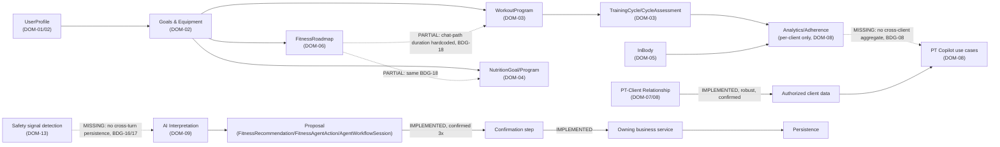

# 12 — Domain Dependency & Architecture Map

All edges below are grounded in this audit's own code-level findings (Phase 1-3), not invented. Edge classification: `IMPLEMENTED` (confirmed by direct trace) / `PARTIAL` (exists but with a confirmed gap) / `MISSING` (confirmed absent) / `UNKNOWN` (not traced).

## Service topology

```mermaid
graph TD
    GW["Gateway<br/>(public entry, reverse proxy, rate limits)"]
    AUTH["auth-service<br/>(Role/JWT source of truth)"]
    USER["user-service<br/>(UserProfile, Contract, InBody, Notification)"]
    FIT["fitness-service<br/>(Workout, Roadmap, TrainingCycle, Nutrition, Exercise)"]
    AI["ai-service<br/>(chat, RAG, agent-workflows, marketplace)"]
    CHAT["chat-service<br/>(Conversation, Message, Call)"]
    GYM["gym-service<br/>(Partner, Branch, Membership)"]
    PAY["payment-service<br/>(Wallet, PaymentTransaction, Commission)"]
    WEB["frontend/web<br/>(Vite+React, Capacitor-wrapped)"]
    MOBILE["frontend/mobile<br/>(Expo/React Native, independent)"]

    WEB -->|HTTPS not enforced, G-03| GW
    MOBILE -->|HTTPS not enforced, G-03| GW
    GW -->|verifies every request via /auth/verify, G-16 sync coupling| AUTH
    GW --> USER
    GW --> FIT
    GW --> AI
    GW --> CHAT
    GW --> GYM
    GW --> PAY
    AI -->|HTTP/Lambda, fitness-agent-tools.ts, never direct DB| FIT
    AI -->|HTTP/Lambda| USER
    AI -.->|internal secret, shared static, G-09| PAY
    FIT -->|coach.service.ts relationship check| USER
    GYM --> PAY
    GYM --> USER
    USER -->|contract money events| PAY
    USER -.->|@anthropic-ai/sdk direct call, bypasses ai-service| ANTHROPIC["Anthropic API"]
    AI --> ANTHROPIC
    AI --> BEDROCK["AWS Bedrock<br/>(mid-edit by concurrent session)"]
    AI --> OLLAMA["Ollama (local Qwen3-4B)<br/>default provider"]
    AI --> QDRANT["Qdrant vector store"]
```

**Notable, independently-confirmed edge**: `user-service` makes its own direct `@anthropic-ai/sdk` calls (Phase 1 backend agent finding) — a second, independent LLM integration point outside the ai-service boundary that the domain model nominally centralizes AI in. Not flagged as a defect (it may be a narrow, contract-related use), but worth the architecture owner's attention as a boundary that doesn't match the stated "AI capability lives in ai-service" mental model.

## Business dependency graph



## Edge status table (summary)

| Edge | Status | Evidence |
|---|---|---|
| User Profile → Goals → Workout/Nutrition | IMPLEMENTED | DOM-02/03/04 confirmed routes+models |
| Roadmap → Workout/Nutrition integration | **PARTIAL** | Proposed-vs-persisted boundary real, but chat-path duration ignores user intent (BDG-18); partial-failure handling honest but no rollback (BDG-19) |
| Workout/Nutrition → Analytics → Roadmap review | PARTIAL | Per-client analytics real; no roster-wide aggregate |
| PT-Client Relationship → Authorized Data → PT Copilot | **PARTIAL, cleanly split** | The authorization layer is IMPLEMENTED and robust (confirmed); the aggregate/copilot layer on top of it is MISSING (BDG-08) — the boundary between "safe" and "missing" is sharp and well-evidenced |
| AI Interpretation → Proposal → Confirmation → Business Service | **IMPLEMENTED**, confirmed 3 independent ways | strongest architectural finding in the audit |
| Safety signal detection → durable constraint on AI Interpretation | **MISSING** | BDG-16/BDG-17, the most safety-relevant finding in the audit |

## Shared components whose failure/gap affects multiple domains

1. **`assertActivePtClientRelationship` / contract-relationship check** (fitness-service ↔ user-service) — every PT-client capability in DOM-07/08 depends on this one gate; it was found robust, so this is a positive single-point-of-trust rather than a risk, but it remains a single point worth monitoring.
2. **Agent-workflow slot-filling machinery** (`agent-workflow/orchestrator.ts`) — shared by all 5 registered workflows; its one confirmed defect class (missing constraint slots) is domain-specific per workflow (nutrition fixed, workout not), but the merge-logic *mechanism* itself is shared and confirmed correct.
3. **`fitness-agent-tools.ts`** — the single file every AI-to-business-data write/read passes through; its `agentUpdatableProfileFieldsSchema` whitelist is the root cause of BDG-16 (no injury field) — a shared chokepoint whose omission cascades into a domain-specific safety gap.
4. **Gateway auth/rate-limit middleware** — every domain's availability depends on it (external register G-16: synchronous auth-service round-trip on every request is a platform-wide single point of failure risk).
5. **`bedrock.client.ts`/`bedrock-credentials.ts`** — currently mid-edit by a concurrent session; any domain capability that would use the Bedrock provider path is in flux right now, not a stable basis for a verdict.
