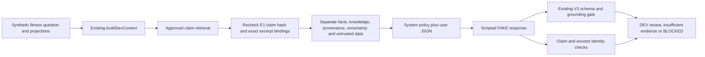

# E2 — Claim-grounded Context & RAG DEV slice

2026-11-02. Branch `feat/advisory-content-v3`, baseline/HEAD `718a00405e06a1ca5f7e9d6485ce14aae60a967d`. Evidence: **CODE AUDIT / TEST FIXTURE / FAKE transport**. No production integration, real model evaluation, independent scientific audit or new evaluation framework.

## What is connected



New components live under `backend/services/ai-service/src/evaluation/ai-coach-claim-dev/`:

| File | Responsibility |
| --- | --- |
| `load.ts` | Loads E1 using fixed handoff pins, validates the entire map and checks original file bytes, including current owner decisions; missing/changed originals stop the CLI |
| `retrieval.ts` | CPU-only claim search using existing `detectConcepts`, `conceptSupport` and text normalization; topic overlap must occur in approved wording, not just an incidental source word |
| `context.ts` | Calls existing `buildDevContext`; rechecks every retrieved record against E1; builds the six required context categories with separate product policies |
| `pipeline.ts` | Builds a role-separated prompt; parses the existing V3 analysis envelope plus claim links; calls existing `evaluateContentV3`; checks full claim/excerpt identity and preserves UNKNOWN support |
| `fixtures.ts` | Seven explicitly scripted, implementer-authored scenarios; no reasoning model or independent labels |
| `run.ts` | `--mock` only; serializes the seven-case slice and simple contract counters to stdout |

Tests: `src/__tests__/ai-coach-claim-dev.test.ts`. This report and those seven files are new. Existing production, evaluation-integrity, E1, review/dashboard and frozen V2 files are unchanged. No commit/merge.

## E1 preflight and source status

E1 validation still succeeds: **35 rows, 34 admitted DEV/offline**, with exact owner decisions and provenance. The registry exposes 30 scientific claims to RAG, three product definitions/policies separately, and C18 only for reviewer context. C22 remains owner-accepted but evidence-held; C22/E12 and A13 are not approved by E2.

E1's 71 bindings still match captured sources (66 literal, five typography/whitespace/case-normalized). This verifies captured text and code identity, not scientific entailment or independent methods review. E2 makes no new literature requests and does not reinterpret source snapshots as live index state.

Formal additional-source curation remains pending at **E07**, including C21's follow-up PMID 16937972/37792272/25594489/18714230/19387368 and C32's follow-up source set. The map's actual bindings, not every article in a snapshot, determine what enters a context. Source approval is distinct from claim approval, and neither owner approval nor retrieval confers independent scientific validation. A13's original/follow-up collagen proposals and the retired C32 narrative excerpt do not enter generation as approved knowledge.

The CLI requires the E1 bundle pin `fb97e98a1177439c05be05615dd9febcad59266a88b9661b294627c2c1ac1c0d` and current owner-decision SHA256 `9cb81c776a1f9080b8c1d1dea46f882a6c942a6bbb272726641237c8e38811d2`. A changed owner file requires a new reconciled map/pin, not implicit adoption of new decisions.

## Retrieval, context and support boundaries

The retriever accepts a question and optional descriptive assessment task. It searches only `registry.listForRag()`, with up to six matches. Existing concept detection is applied to both query and approved claim wording; this excludes “organ volumes” as a match for training volume and preserves both tempo and RIR/failure in a mixed-topic query. Ranking is deterministic lexical/topic matching, not semantic relevance or entailment. Unrecognized phrasing may return empty and needs clarification.

The context has distinct `userFacts`, `trainingObservations`, `approvedScientificKnowledge`, `evidenceProvenance`, `uncertainty`, and `untrustedContent`. Synthetic owner projections retain values/quality/provenance; no e1RM, training prescription, threshold or outcome authority is recalculated. Product policies C20/C23/C24 remain separate from scientific research. Missing namespaces and unassessed dimensions are explicit.

Generation receives exact accepted wording, ID/version/hash, source passages, population/applicability, evidence limitations and unsupported inferences. It does not receive retired draft wording, AI rewrites, held claims or the complete owner-decision file. A malicious replacement excerpt is rechecked against the full pinned record and quarantined before generation, even if the replacement is rehashed or names a genuine source. History and supplemental untrusted text remain user JSON data; the system policy does not contain them. This separation reduces injection opportunities, without proving universal injection resistance.

Structured output retains existing V3 `analysis` and `sourceLinks`, adding `claimLinks` containing generated-claim index, knowledge-claim ID and hash. A sourced general principle must reproduce the accepted wording and link every bound scientific excerpt for that whole claim. Code provenance remains separate; it is not labeled a scientific excerpt.

| Check | Meaning |
| --- | --- |
| FOUND | Topic/lexical relevance only |
| Valid claim/source/excerpt identity | Exact correspondence to an E1 admitted record; not support for a new conclusion |
| `OWNER_ACCEPTED_GENERAL_TEXT_ONLY` | Exact owner-accepted general wording with valid links; personal/scientific support still UNKNOWN |
| `UNKNOWN_PERSONAL_APPLICABILITY` | A hypothesis/personal use has not been established by retrieving group evidence |
| `UNKNOWN_ENTAILMENT` | Altered text/role has no semantic support determination from this slice |
| BLOCKED | Schema, reference/binding or existing V3 hard failure |

Personal applicability is **UNKNOWN** for every retrieved claim: the DEV profile/logs do not verify age, health, training status, measurement protocol or causal relevance. A valid personal hypothesis or changed conclusion is not automatically released: unresolved linked assertions return `INSUFFICIENT_EVIDENCE`, raw output retained. A candidate that satisfies the narrow checks can only become `DEV_REVIEW_ONLY`; `scientificPass=null` and real model quality is `NOT_MEASURED`.

The legacy V3 source shape receives actual scientific excerpts and explicitly separated owner-approved summary text. Its required `year=0`/empty DOI are unavailable-metadata sentinels in the gate adapter, not publication facts; generation uses the original provenance. `humanReviewed=false` is the legacy independent-review field, with actual owner acceptance carried separately. Its `CURATED_EVIDENCE` shape field is not a new source-curation approval or production admission. No scientific source bytes or legacy gate rules were changed to accommodate this adapter.

## Fixture trace and outcomes

These responses are scripted contract fixtures. The scripts choose approved text and observations explicitly; their apparent correctness does not measure LLM reasoning.

| Case | Relevant knowledge/control | Fixture result |
| --- | --- | --- |
| A: reps increase at constant load | C12; also retrieves C28/C03/C14 | Describes 40 kg, reps 8→10; insufficient for direct strength/muscle assessment; DEV_REVIEW_ONLY, existing soft flags preserved |
| B: small e1RM change | C21 | Copies estimated 60→60.3 kg and supplied 0.5% projection; no “true strength increased” conclusion, no CAL02 threshold/CAL03 taxonomy; DEV_REVIEW_ONLY with existing flags |
| C: 20 weekly sets | C32a, plus historical C04 | General research range and limitations retained; no mandatory personal volume prescription; DEV_REVIEW_ONLY |
| D: tempo and RIR | C32b/C32c, also C14 | Both topics retained, phase versus whole-rep duration distinguished; no universal tempo/failure mandate; DEV_REVIEW_ONLY |
| E: quantify muscle-size change from e1RM | Related claims can be FOUND, but no suitable personal measurement | Records the estimate and abstains from quantitative muscle inference; DEV_REVIEW_ONLY with insufficient assessment |
| F: explicitly request C22 | C22 excluded; no scientific claims supplied | Insufficient assessment, no reconstructed C22 evidence or new approval |
| G: rehashed wrong excerpt | Swap C32a passage for genuine same-topic C13 strength passage | Quarantined before generation; final BLOCKED even while other relevant knowledge remains FOUND and the V3 gate has no rule match |

Concrete path for A: question → existing Context Builder keeps a synthetic TRAINING log `{weightKg:40, baselineReps:8, currentReps:10}` → shared progressive-overload concepts retrieve C12 with the exact ACSM passages → applicability remains unknown → FAKE transport emits the descriptive log observation plus unchanged C12 as `GENERAL_PRINCIPLE`, with empty personal fact IDs on the principle → identity checks and existing V3 gate → `DEV_REVIEW_ONLY`. The assessment remains `INSUFFICIENT_DATA`, not `NO_OBSERVED_CHANGE` merely because load stayed flat. It does not assert measured maximal-strength gain, hypertrophy, the cause of a plateau, or a prescribed increase.

The dedicated tests additionally change a valid cited general statement into a personal hypothesis: identity remains valid, but support becomes `UNKNOWN_PERSONAL_APPLICABILITY` and release is `INSUFFICIENT_EVIDENCE`. Changed general wording becomes `UNKNOWN_ENTAILMENT`. A reproduction also relabeled exact approved scientific text as a personal observation and omitted every scientific link: it previously reached DEV review in the new slice; the final slice blocks it with `SCIENTIFIC_CLAIM_AS_PERSONAL_OBSERVATION` using exact membership, not a new language regex. Fabricated metric values and recommendations are still blocked by the unchanged V3 gate.

## Verification

**TEST FIXTURE**: 17 new tests pass. Scoped required regression: **21 files, 260 pass, 0 fail, 0 skip, 0 cancelled**: 12 advisory, three existing `ai-coach-dev`, the E1 and E2 suites, and four RAG CPU-fixture suites. This is not full repository regression. TypeScript `pnpm exec tsc --noEmit`: exit 0.

Seven-case CLI snapshot, ignored local artifact: `artifacts/ai-coach-claim-dev/e2/slice.json`.

| Contract counter | Observed |
| --- | ---: |
| Expected approved target claims retrieved, A–D | 5/5 |
| C22 supplied to generation | 0 |
| Preserved source-reference occurrences | 63/63 |
| Preserved population/applicability/limitations/inference-scope occurrences | 22/22 |
| Wrong-excerpt controls quarantined/blocked | 1/1 |
| Structured contexts / existing V3 gate calls | 7 / 7 |
| FAKE transport calls | 7 |
| Real model / embedding / vector-DB calls | 0 / 0 / 0 |

These are implementer-authored target/contract counters, not research recall, precision, independent scientific support or model accuracy. Duplicated source references/claims across cases are counted as occurrences. Six DEV review results and one blocked result do not establish six scientifically correct answers.

```powershell
# cwd: advisory-content-v3/backend/services/ai-service
pnpm exec tsx src/evaluation/ai-coach-claim-dev/run.ts --mock
pnpm exec tsx --test src/__tests__/ai-coach-claim-dev.test.ts
$env:ADVISORY_V2_ARTIFACT_DIR='C:/D_Backup/project_personal/fitness-assistant/artifacts/ai-advisory-progress/bedrock-guarded-v2'
$advisoryTests=@(rg --files src/__tests__ -g 'advisory-*.test.ts')
$devTests=@(rg --files src/__tests__ -g 'ai-coach-dev*.test.ts')
pnpm exec tsx --test @advisoryTests @devTests `
  src/__tests__/scientific-claim-map-v3.test.ts `
  src/__tests__/ai-coach-claim-dev.test.ts `
  src/__tests__/rag-retrieval-v2.test.ts `
  src/__tests__/rag-remediation-4-7r.test.ts `
  src/__tests__/rag-ood-safety-4-7r2.test.ts `
  src/__tests__/rag-safety-signals-4-7r3.test.ts
pnpm exec tsc --noEmit
```

Protected bytes: the original **55** review/audit/dashboard files plus all **13** E1 deliverables remain unchanged (68 checks). Frozen V2 tests run without skips; evidence-pack SHA256 stays `4251adb6c9aa0d88d54d6b69a88824b60e37ce33a74467b822bf042483e1b8ea` and frozen results stay `4f3f376ac81a93f645ba86a49a241f2d761e2bdf29388dcb44f79530e16c857a`. Before/final manifests and scoped logs are under ignored `artifacts/ai-coach-claim-dev/e2/`.

No Bedrock/Ollama, embedding, vector DB, crawler, DB mutations, source ingestion, production route/config changes or merge. `--live` is rejected before provider use. Evaluation integrity remains closed and unchanged.

## Limitations, owner decisions and E3

No new owner decision is needed to complete this DEV fixture slice. Existing pending items remain: E12/C22 evidence binding, A13 original-source verification, E07 source curation, E02/CAL02 threshold and E01/CAL03 assessment taxonomy. The E1 dashboard import fragment remains prepared, not automatically loaded or approved. No owner file or dashboard catalog was edited.

This is a narrow exact-text generation path: a potentially correct paraphrase returns unknown, and lexical retrieval can miss aliases or include neighboring topics. The current gate still has limited adapters/text checks: A/B/E/F retain soft flags, including ambiguous/bounded assessment and language checks. An unrecognized personal inference in unrestricted prose can still require semantic review. No new regex rules were added to imitate reasoning or dismiss these flags. Population fit, source entailment and scientific quality are not computed by claim identity checks.

E3 should reuse the existing accepted evaluation infrastructure. Before any real model call: authorize the concrete model/scope/budget, reconcile current owner/source pins and applicable pending items (or explicitly keep them excluded), freeze prompts/contracts/claims/code, and arrange independently reviewed cases and scientific annotations. Evaluate raw errors and gate retention separately, with applicability/unsupported-personal-inference labels and real token/latency/cost measurements. E2's fake target coverage cannot substitute for that evaluation. No production enablement follows from E2.
