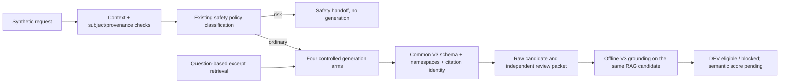

# AI Coach DEV architecture — controlled evaluation blockers

> Historical snapshot qua `d344a75a`. Protocol hiện tại đã thay đổi; xem [real evaluation readiness](ai-coach-real-evaluation-readiness.md) cho sáu arms, adapter, source registry và annotation infrastructure mới.

Cập nhật 2026-11-01, branch `feat/advisory-content-v3`. Review base: `2c4806b9`. Bản này thay mô tả harness cũ 5 arm/25 mock calls; số liệu cũ vẫn là lịch sử tại commit đó, không phải kết quả model.

Trạng thái: **PREPARED_PENDING_INDEPENDENT_REVIEW**. Chi tiết finding, kiểm thử và giới hạn: [handoff blockers](ai-coach-evaluation-blockers-handoff.md). Evidence tier: **CODE AUDIT / TEST FIXTURE**.

## 1. Thành phần có sẵn và phần được reuse

| Thành phần | Code hiện có / cách sử dụng |
| --- | --- |
| Bedrock | `services/llm.service.ts` đã hỗ trợ Bedrock chat và embedding riêng, explicit system role và telemetry; `services/bedrock.client.ts` có Converse/Cohere và transport seam. DEV không import hoặc gọi chúng. Không thay provider config. |
| Runtime | Các route/controller, `services/rag.service.ts`, `llm/orchestrator.service.ts` đã có context/history/retrieval, session ownership và persistence. Slice DEV không nối vào chúng. |
| Prompt/context | `llm/prompt_builder.ts` có policy/template tổng quát; `services/context-assembler.ts`, coach-state và `coach/coach_context_builder.ts` đã có context. DEV reuse Fact/EvidenceItem contract và projections, không reuse policy tạo plan khi thiếu dữ liệu. |
| Retrieval | Reuse `retrieveV2(question,V2Io)`, `buildKnowledgeSource`, concept resolver, safety resolver/guard. Chỉ sửa shared concept aliases cho e1RM và muscle-size/thickness; không đổi flag hoặc deploy. IO DEV dùng CPU query handles/lexical fixtures, không phải embeddings. |
| Corpus pipeline | Web extractor bỏ HTML noise; local JSONL reader trim/hash; scoring/review queue, chunking và vector writer có provenance. Các heuristic đó không tự xác nhận scientific support. DEV không crawl/ingest/upsert. |
| Grounding | Reuse V3 schema/gate và excerpt resolver. Bổ sung outcome support từ server facts, reference checks dùng chung và review packets. V2 source/scenarios/outputs/scores giữ nguyên. |

Làm sạch tài liệu giúp truy xuất và truy vết; không tự biến nội dung thành tri thức đã kiểm chứng. RAG đưa excerpts vào context lúc chạy, không cập nhật trọng số LLM.

## 2. Pipeline và boundary

Code: `backend/services/ai-service/src/evaluation/ai-coach-dev/`.



Context giữ nguyên owner values, quality, timestamps và namespace. Profile thuộc user-service; training/measurement/nutrition projections thuộc fitness-service. Conversation là unverified claim, không thay facts. Labels phân biệt direct log observation, e1RM derived estimate và missing/stale/unverified dữ liệu. Các subject synthetic chỉ phục vụ schema/isolation tests, không phải authentication hoặc real service verification.

Outcome support không dùng model-declared basis làm bằng chứng. Attendance-only không đủ để khẳng định progress/no change. e1RM không xác nhận muscle-size outcome. Các adapters tường minh xử lý e1RM, DEV direct-1RM projection, measured weight trajectory và body-fat trend; unknown outcome kinds cần review/adapter, không bị phủ quyết mặc định. Không tạo production projection writer hoặc analytics authority mới. Kiểm tra deterministic exercise/unit chỉ áp dụng khi identity/unit đối chiếu được.

Prompt có system policy, user intent, personal context, scientific evidence và analysis/output contract. Mọi data nằm trong user JSON không tin cậy. Output chung là `{analysis:AnswerV3,sourceLinks}`; phân biệt observation, principle, hypothesis, limitation và conclusion. Không xuất hidden chain-of-thought, không dùng rationale làm proof reasoning.

## 3. Controlled ablation

| Generation arm | Thay đổi so với arm trước |
| --- | --- |
| V3_SCHEMA_LEGACY_POLICY | Flat organization, policy readonly tương đương legacy, cùng V3 contract; không phải frozen V2 prompt |
| FIVE_LAYER_POLICY | Chỉ đổi organization, cùng personal information |
| FIVE_LAYER_CONTEXT | Thêm namespace/provenance/missingness annotations, không thêm measured facts |
| FIVE_LAYER_CONTEXT_RAG | Thêm selected exact scientific excerpts |

Mỗi arm dùng cùng fact/source ID allowlists, schema, reference checks, model/sampling settings, seed theo repetition và retries=0. Allowlist chỉ xác nhận identity; chỉ excerpt thực được cấp mới có thể được cite. Source IDs không làm nguồn trở thành support.

Mỗi arm chạy hai policy MINIMAL/FULL và hai repetition; order được rotate theo case/repetition. MINIMAL giữ role, readonly boundaries và contract; FULL thêm nguyên tắc domain chung. Không đưa case ID, evaluation labels hoặc arm name vào provider request. Các prompt có thể chứa số liệu cá nhân, không chứa expected answer.

`V2_BASELINE` chỉ là historical/migration reference riêng. `GROUNDED_OFFLINE` không phải generation arm: dùng chính raw object của RAG candidate, không gọi provider và không sửa đáp án. Báo raw quality và post-gate eligibility; blocked không được tính là đúng.

Mock luôn abstain và copy visible facts để thử serialization. Nó không tra case/gold label và không mô phỏng reasoning. Không chấm mock assessment accuracy.

## 4. Retrieval/corpus/authorship

Root cause case muscle-scope cũ: concept aliases thiếu “kích thước cơ”/muscle-size/thickness và `e1RM` không khớp `1RM`. Đã thêm aliases theo khái niệm, không hardcode case ID. V2 vẫn nhận câu hỏi gốc trước query expansion.

Fixture index và selection ở cấp excerpt; title không làm một excerpt không liên quan trở nên phù hợp. Chỉ quotes đúng registry ID và qua body/topic gate được đưa vào prompt. Không tự phục hồi toàn bộ source excerpts hoặc assistant summaries khi một quote bị ablate.

Corpus supplement riêng: [corpus-supplement.json](../../data/eval/ai-coach-dev/corpus-supplement.json). Hai nguồn scientific lịch sử vẫn từ frozen pack/map; distractors và cặp conflict do assistant tạo được ghi synthetic, không có DOI và bị loại khỏi scientific evidence. Same-topic group result có thể relevant nhưng không chứng minh nguyên nhân cá nhân. Chưa có cặp nghiên cứu thật mâu thuẫn được curated độc lập.

Prompt/review packet tách:
- `originalScientificExcerpts`: quote/locator/authorship.
- `sourceMetadata`: title/DOI/URL/year.
- `assistantAuthoredInterpretation`: applicability/limitations/review scope.
- Semantic support/applicability labels: `null` chờ review.

Các trạng thái: FOUND, EMPTY_NO_MATCH, EMPTY_UNRESOLVED, EMPTY_OUT_OF_DOMAIN, EMPTY_SAFETY, UNAVAILABLE, DISABLED. Safety handoff có disposition riêng và bỏ generation; không xem là absence thông thường. IO lỗi bỏ partial evidence. FOUND chỉ qua relevance heuristic, không phải scientific pass.

## 5. Evaluation và bằng chứng

[Protocol review](../../data/eval/ai-coach-dev/evaluation-protocol.json) chuẩn bị target 40 case độc lập (minimum 30), reviewer khác implementer, 10 case reserved/unopened do reviewer sở hữu. **Phần reserved chưa được tạo/bàn giao**. Hiện có 40 implementer-authored DEV inputs, gold labels=null; không gọi đó là independent held-out.

Metrics chuẩn bị: factual correctness, source-to-claim support, unsupported personal claims, uncertainty/abstention, Likert usefulness, raw/post-gate coverage và tokens/latency/cost. Các metric chưa đo được giữ null. Review độc lập phải đọc cả claims, assessment/conclusion và questions, không dùng model KEEP hoặc citation ID làm proof support.

Tại `backend/services/ai-service`:
```powershell
pnpm exec tsx src/evaluation/ai-coach-dev/run.ts --mock
pnpm exec tsx --test src/__tests__/ai-coach-dev.test.ts src/__tests__/ai-coach-dev-retrieval.test.ts src/__tests__/ai-coach-dev-protocol.test.ts
pnpm exec tsc --noEmit
```

Kết quả lượt này: 228 test pass trong 19 file được nêu đầy đủ ở handoff; compiler exit 0. Harness: 608 mock calls, 0 model/embedding/vector-DB calls; 40 DEV cases. RAG status coverage: 29 FOUND, 4 UNRESOLVED, 3 NO_MATCH, 1 UNAVAILABLE, 2 SAFETY, 1 OUT_OF_DOMAIN. Đây không phải semantic recall.

Trong 160 RAG slots, 8 safety-routed không generation, 152 raw candidate; 148 post-gate eligible, 4 blocked. Tỷ lệ giữ 148/152 không phải accuracy. Raw/post-gate correctness vẫn null. Frozen V2 integrity giữ nguyên.

## 6. Readiness còn thiếu

Cần Claude Code review các outcome adapters, parity controls, quote selection/authorship, safety handoff, corpus scope và denominator metrics. R-E–R-H vẫn thiếu mô tả finding để phân loại; R-A/R-D là bounded deterministic checks, không có bảo đảm phủ mọi paraphrase.

Chưa có independent case approval/held-out labels, expert/current corpus review, real contradictory scientific pair, semantic adjudication, authenticated context adapter hoặc controlled model run. Vì vậy status là PREPARED_PENDING_INDEPENDENT_REVIEW, chưa tự đánh dấu READY_FOR_CONTROLLED_MODEL_EVALUATION. Không nối production route, không bật flag, không sửa Bedrock/DB/index, không merge hoặc gọi API trả phí.
