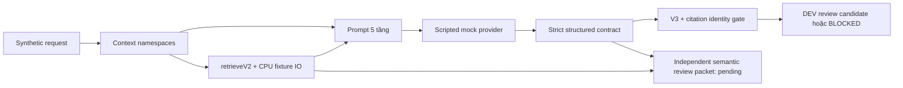

# AI Coach — V3 closure và DEV architecture vertical slice

Ngày: 2026-11-01. Phạm vi: branch `feat/advisory-content-v3`, worktree `fitness-assistant-worktrees/advisory-content-v3`; production source đối chiếu tại reviewed base `e3a45b29`. Đây là **CODE AUDIT + TEST FIXTURE**, không phải kiểm chứng production hay nghiên cứu chứng minh cải thiện chất lượng LLM.

## 1. Ranh giới bàn giao

- V3 closure commit riêng: `7915a6b3`. R-A–R-D có patches và regression. Chi tiết: [v3-closure.md](../../data/eval/advisory-progress-dev/reviews/v3-closure.md).
- Attachment không cung cấp nội dung R-E–R-I. Phản hồi “OKE” không bổ sung finding: năm mục vẫn `PENDING_CLASSIFICATION`, chưa xác định severity; không tự đánh dấu đã xử lý.
- Giai đoạn này thêm pipeline DEV, mock provider, review packet và evaluation harness. Không thay production route, prompt, provider config hoặc feature flag. Không merge.
- Không sửa 24 frozen answers, historical scores, evidence pack hay các file V2 `experiment.ts`, `scenarios.ts`, `run.ts`, `guarded.ts`.

## 2. Architecture gap analysis dựa trên code

Các đường dẫn dưới đây tương đối với `backend/services/ai-service/src/`. Phạm vi đọc tập trung vào các luồng gọi, contract, selection, provenance và persistence liên quan; không tuyên bố audit toàn repository hoặc đã kiểm chứng runtime đang deploy.

| Thành phần | Hiện có trong code | Reuse / khoảng trống |
| --- | --- | --- |
| Model/provider | `services/llm.service.ts`: `LLM_PROVIDER=bedrock` dùng `BEDROCK_CHAT_MODEL`, chat/embedding chọn độc lập. `callLLM` có telemetry, `systemPrompt` tách role. `services/bedrock.client.ts` có Converse, Cohere embedding, timeout/refusal và transport seam. | Đã có Bedrock; không cần chuyển provider. DEV không import/call service này. Default fallback trong code vẫn Ollama; audit này không xác nhận env của deployment. |
| Orchestration/API | `routes/ai.routes.ts`, `controllers/ai.controller.ts`, `services/rag.service.ts`, `llm/orchestrator.service.ts`: authenticated request, session ownership, replay/idempotency, agent early route, context/history/memory/retrieval, prompt và model response. | Giữ các route hiện tại. DEV không nối vào `/ask` hoặc `/agent`, không ghi conversation hay kế hoạch. |
| Prompt/history | `llm/prompt_builder.ts` ghép nhiều policy, profile, retrieval, recommendation và history. Orchestrator gọi builder rồi `llmService`; explicit system role đã được service hỗ trợ. | Không tái sử dụng toàn bộ legacy prompt: các nhánh của nó còn yêu cầu plan mẫu khi thiếu dữ liệu, khác boundary advisory chỉ đọc. Việc hợp nhất policy cần review riêng, chưa sửa ở đây. |
| Context | `services/context-assembler.ts` đọc theo needs; enterprise-data và coach-state giữ provenance/owner. `coach/coach_context_builder.ts` tạo CoachContext, có cả derived calculations. `conversational-intelligence/global/progress-review.ts` compose EvidenceItem từ projection, không tự tính lại analytics. | Reuse **EvidenceItem/Fact contract**. Không gọi context builder tổng quát để tính lại body/goal; DEV chỉ chuẩn hóa synthetic projections và namespace. Adapter sang authoritative reads thực chưa triển khai. |
| Personal interpretation | `conversational-intelligence/global/personalized-interpretation.ts` đã có bounded readonly narration/fallback và knowledge context; knowledge query tạo theo topic, coverage dựa số nguồn. | Đây không phải claim-entailment verifier hoặc proof reasoning. Không nới validator của luồng đã có để làm slice mới. |
| Retrieval | `llm/retrieval-v2.ts`: pure `retrieveV2(question, V2Io)`, concept/topic gate, query expansion, per-class ranking, quotas/dedup, conflict scope. `llm/knowledge-source.ts` phân biệt curated/reference/synthetic/catalog. `llm/retriever.ts` nối embedding/vector store; `vector-store/provider.ts` chọn Qdrant/OpenSearch. | **Reuse trực tiếp retrieveV2 và buildKnowledgeSource** với CPU fixture IO. Không import retriever có live defaults. Relevance/conflict heuristics không xác nhận claim được nguồn hỗ trợ. |
| Làm sạch tài liệu | `knowledge-pipeline/web.ts` bỏ script/nav/footer, trích text và metadata; `local-evidence.ts` đọc JSONL, trim/min-length/hash; `scoring.ts` chấm trust/quality và safety theo rules; `service.ts` đưa review/reject/accept; `chunking.ts` chuẩn hóa whitespace, sentence/word boundaries; `qdrant-writer.ts` embed/upsert kèm provenance. | Có pipeline xử lý dữ liệu. Điểm trust/quality không phải expert review. Không mặc định mọi JSONL là nguyên văn bài báo hoặc claim đúng. DEV dùng excerpt registry đã có, không crawl, ingest, embed hay cập nhật corpus production. |
| Grounding/evaluation | `evaluation/advisory-progress/`: strict V2/V3 schemas, frozen integrity, deterministic facts/language checks, bounded repair và source-ablation preparation. | **Reuse V3 gate**, V2 guarded prompt/schema, excerpt resolver và hai nguồn lịch sử. Thiếu independent semantic labels, corpus hiện hành được chuyên gia duyệt và live model evaluation. Không có scientific pass tự động. |

“Làm sạch” biến văn bản thành dữ liệu dễ truy xuất, có provenance; không tự biến nó thành tri thức đã được chứng minh. Trong RAG, tài liệu được đưa vào context lúc chạy; pipeline này không huấn luyện hoặc cập nhật trọng số LLM.

## 3. DEV pipeline đã triển khai

Code: `src/evaluation/ai-coach-dev/{context,retrieval,pipeline,review,fixtures,evaluation,run}.ts`.



### Prompt và analysis contract

Năm tầng logic: (1) system role/policy; (2) original question và readonly task; (3) personal context; (4) scientific excerpts; (5) analysis instructions và output contract. System chỉ chứa policy/contract cố định; question, context, history và evidence nằm trong user JSON không tin cậy. Delimiter/role separation là biện pháp giảm rủi ro, chưa được chứng minh chống mọi prompt injection.

Output gồm `analysis: AnswerV3` và `sourceLinks` trỏ `claimIndex → sourceId → excerptIds`. Các enum tách observation, general principle, measurement limitation và personal hypothesis. Kết luận dùng `assessment`/`rationaleSummary`; hypothesis cần facts, nguồn, uncertainty và missing information. Instructions yêu cầu cân nhắc giải thích thay thế có căn cứ hoặc thừa nhận chưa biết; không ép model bịa nguyên nhân. Không yêu cầu xuất hidden chain-of-thought, không coi một rationale hợp lệ là chứng minh reasoning.

Zod là executable contract; mô tả contract trong prompt vẫn cần kiểm thử tương thích khi được phép chạy model thật. Cách tiếp cận hiện tại là role/instruction + structured output + provenance/RAG + decomposition vừa đủ + verification. Chưa thêm many-shot, ToT, multi-agent debate hoặc LangGraph: pipeline đơn tuyến này chưa cần orchestration framework.

### Context builder

- Boundary chỉ nhận `SYNTHETIC_DEV`, subject có tiền tố synthetic; kiểm tra snapshot/history cùng subject, không trùng fact/namespace, domain khớp provenance.
- Profile thuộc user-service; measurements/training/nutrition projections thuộc fitness-service. Conversation là unverified statements, không thay authoritative facts.
- Giữ nguyên giá trị projection, quality, thời điểm và provenance. Không tính e1RM, calo, load hoặc assessment authority mới cho production.
- Namespace không có facts được ghi rõ. Sleep/recovery/load history/measurement protocol được ghi là **không được slice đánh giá**, không suy diễn thành tình trạng thực của người dùng.
- “Verified” ở DEV chỉ là fixture/schema consistency. Chưa có authenticated HTTP/DB adapter xác minh dữ liệu thật, freshness hoặc consent. Các nhãn synthetic không phải một cơ chế authentication.

### Retrieval và nguồn

`retrieveV2` nhận **câu hỏi gốc**, rồi dùng chính query expansion/gate của code hiện tại. Fixture `embed()` tạo query handles và `search()` dùng lexical overlap trên registry cục bộ; không phải semantic embeddings. `trace.embeddings` của V2 đếm lần gọi seam này, **không** phải số request embedding thật; manifest ghi `embeddingCalls=0`.

Registry reuse `evidence-pack.json` và `evidence-claim-map-v2.json`, không sửa bytes. Chỉ trả nguồn curated có trong registry và các quotes của nguồn đó; không lấy arbitrary text từ search response làm bằng chứng. Retrieval chọn ở **cấp source với tập excerpt nhỏ**, chưa phải fine-grained passage reranker. Title/DOI/applicability/limitations được giữ; summary/findings không được bơm lại để bù excerpt đã loại.

- `FOUND`: qua topic/relevance gate, claim support vẫn `NOT_EVALUATED`.
- `EMPTY`: không có nguồn phù hợp; vẫn được mô tả personal facts, hỏi thêm, không có sourced principle/hypothesis.
- `UNAVAILABLE`: IO lỗi, bỏ toàn bộ partial evidence; phân biệt với không tìm thấy.
- `DISABLED`: arm không RAG.

Hai nguồn 2009/2017 chỉ mới được assistant đối chiếu abstract ở workflow trước, không có independent expert review/full-text review. Slice này không cập nhật currency hay thẩm định lại nguồn. Không dùng các nguồn đó để chứng minh nguyên nhân cá nhân hoặc kê chương trình.

### Grounding và semantic review

V3 giữ các hard invariant về metric/reference và cấm recommendation; source-link checker kiểm tra claim/source/excerpt identity. Grounded arm chặn schema lỗi, invalid/missing excerpt links hoặc V3 `BLOCKED`; raw candidate và diagnostics được giữ cho review. Không retry/repair tự động trong slice.

`NO_RULE_MATCH_NOT_CONTENT_PASS` và `FLAGGED_FOR_REVIEW` đều chỉ cho `DEV_REVIEW_ONLY`. Không đường nào phát scientific pass hay production response. Các arm không grounding vẫn ghi diagnostic citation issues nhưng không áp gate đó để giữ khác biệt treatment; chúng không được release production.

`review.ts` tạo packet riêng cho từng V3 claim: text/type, referenced facts, exact cited excerpts, applicability và limitations. Với V2 hoặc output lỗi, packet giữ raw candidate cùng facts để reviewer đọc trực tiếp. Reviewer còn phải đọc assessment, conclusion và missing questions. `sourceSupport`, `factSupport`, `personalApplicability`, reviewer rationale và scientificPass đều `null` trước review. Đây là chuẩn bị semantic review, chưa có semantic model/human reviewer chạy.

## 4. Evaluation protocol

Năm arm: `V2_BASELINE`, `FIVE_LAYER_ONLY`, `FIVE_LAYER_CONTEXT`, `FIVE_LAYER_CONTEXT_RAG`, `GROUNDED`. V2 dùng guarded A trên **case mới**, không lấy historical scores làm baseline cho thí nghiệm này. V2 và V3 khác output contract nên đây là migration comparison; không thể quy toàn bộ chênh lệch cho prompting.

Các arm dùng cùng question/facts/history. V2 nhận adversarial conversation qua `untrustedText`; mọi case có `profile.goal=null`. Arm five-layer-only nhận raw snapshot; context builder bổ sung namespace/absence labels, không thêm personal facts. Hai arm cuối cùng dùng chung corpus/retrieval. Grounding chỉ thay release decision; vẫn giữ raw output để đánh giá lỗi trước gate và coverage/abstention sau gate.

Năm case mới: Overhead Press 70→70 kg trong 6 tuần; 70→77 kg; attendance 18/20 không có metric; history chứa số liệu xung đột và injection; hỏi kích thước cơ khi chỉ có e1RM. ID/numbers khác bộ frozen cũ, nhưng **vẫn là implementer-authored DEV cases**, không phải held-out hoặc nhãn độc lập. Scripted mock đọc fixture labels để tạo đáp án: đó là kiểm tra plumbing, không phải đánh giá reasoning/generalisation.

| Metric | Tự động có thể báo hiện tại | Còn cần review độc lập |
| --- | --- | --- |
| Factual consistency | Số metricAssertion được kiểm tra; số mismatch so với projection và V3 alerts | Prose/fact entailment; không suy “0 mismatch” thành toàn bộ câu trả lời đúng |
| Source support | Source/excerpt identity issues | Supported/partial/unsupported/NA theo exact quote và scope; tỷ lệ supported trên các claim có thể đánh giá |
| Unsupported personal claims | Deterministic alerts, gồm nội dung ngoài claims qua V3 | Số personal claim thiếu hỗ trợ / tổng personal claim, kể cả conclusion/questions |
| Uncertainty | Assessment match và required-question coverage trên DEV labels | Overconfidence, abstention và mức chắc chắn phù hợp; chưa có probability calibration |
| Usefulness | Chưa chấm (`null`) | Likert 1–5 có anchors trong protocol, chấm mù theo intent, unknowns và follow-up cụ thể |

Lần model evaluation sau cần phê duyệt riêng: pin model/prompt/corpus/code, paired repeated runs, báo latency/tokens/cost, independent blinded labels, leakage audit và uncertainty intervals. Theo dõi cả raw unsupported claims và tỷ lệ bị chặn; không được nâng điểm bằng cách âm thầm loại toàn bộ câu khó. Chưa có kết quả để xếp hạng năm arm.

## 5. Chạy và bằng chứng

Tại `backend/services/ai-service` trong worktree này:

```powershell
pnpm exec tsx src/evaluation/ai-coach-dev/run.ts --mock
pnpm exec tsx --test src/__tests__/ai-coach-dev.test.ts
pnpm exec tsc --noEmit
```

CLI chỉ nhận `--mock` (hoặc không có argument), từ chối `--live`; xuất JSON ra stdout, không ghi DB/artifact hoặc thay file đầu vào. Manifest pin case/corpus/prompt/implementation/reused-code và source-file hashes. Scripted mock 5 case × 5 arm = 25 mock calls; Bedrock/LLM/embedding/vector-DB calls = 0.

Snapshot mock local của lượt bàn giao: `artifacts/ai-coach-dev/mock-a08b806c89a14ac2b2d70ea0b5633c78/experiment.json` trong worktree (ignored, không commit). Cả 25 output đều `DEV_REVIEW_ONLY`; không output nào là scientific pass.

Evidence label **TEST FIXTURE**:

- 11 advisory suites + `ai-coach-dev.test.ts`: **142 pass, 0 fail, 0 skip** khi trỏ đến artifacts V2 đã pin.
- Cùng scope không có artifacts trong worktree: **139 pass, 0 fail, 3 skip**; chỉ skip các kiểm tra cần local frozen artifacts.
- Existing `rag-retrieval-v2.test.ts`: **15 pass**, CPU fixtures.
- AI-service `tsc --noEmit`: exit 0.
- Không có REAL HTTP/API, REAL BROWSER, BACKEND INTEGRATION hoặc model evaluation trong lượt này. Đây không phải full repository regression.

Frozen evidence-pack SHA256 giữ nguyên `4251adb6c9aa0d88d54d6b69a88824b60e37ce33a74467b822bf042483e1b8ea`; frozen results giữ nguyên `4f3f376ac81a93f645ba86a49a241f2d761e2bdf29388dcb44f79530e16c857a`. Các historical score/answer vẫn do frozen integrity test đối chiếu.

## 6. Điểm cần Claude Code review và phần chưa tích hợp

Review boundary synthetic/subject isolation; role split và prompt-contract drift; V2 adapter/registry/excerpt selection; empty/error semantics; nguồn có thực sự hỗ trợ từng claim hay chỉ cùng chủ đề; consistency giữa raw output, release gate và reviewer packet; tính công bằng/confounds của năm arm.

Chưa triển khai real authoritative context adapter, Bedrock adapter cho slice, corpus upgrade/expert review, semantic judge độc lập, annotation storage/aggregation, held-out research set hoặc model experiments. Chưa được phép nối production route, bật flag, sửa legacy policy hoặc gọi model/embedding/vector service. Các hạng mục đó cần phạm vi và phê duyệt riêng; không dùng mock pass để mở production.
