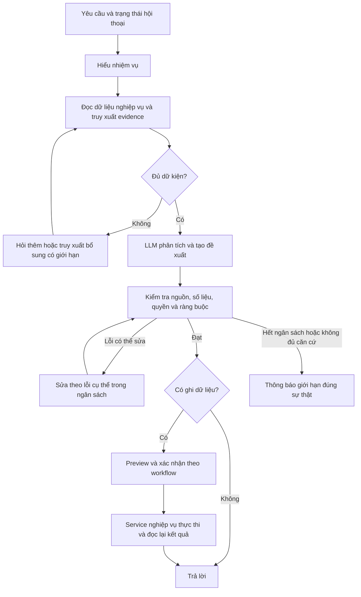

# Kế hoạch Prompt, Evidence, AI Agent và đánh giá Gymini

Ngày lập: 2026-10-27 (Asia/Saigon). Trạng thái: **IN PROGRESS — đã có baseline và experiment A–D ở mức DEV; chưa rollout thay đổi prompt/agent**.

Đây là kế hoạch được lưu từ trao đổi thiết kế, không phải báo cáo nghiệm thu.
Code/config đang chạy là nguồn sự thật. Bắt đầu bằng một luồng tư vấn có bằng
chứng; không mặc định thay toàn bộ kiến trúc hoặc migrate sang framework mới.
Theo dõi đầu việc tại [STATUS](../STATUS.md).

## 1. Mục tiêu và phạm vi đầu tiên

Luồng đề xuất: người dùng hỏi vì sao kết quả tập luyện chưa tiến bộ → lấy dữ
liệu liên quan → truy xuất bằng chứng → LLM phân tích → kiểm chứng → trả lời.
Nếu thiếu dữ liệu, hỏi điều ảnh hưởng trực tiếp đến kết luận. Không tự thực
hiện thay đổi chương trình/goal từ câu hỏi giải thích.

LLM phải tổng hợp dữ kiện và áp dụng điều kiện của bằng chứng vào hoàn cảnh
người dùng. Đánh giá bằng kết quả và sự phụ thuộc vào bằng chứng; không dùng
độ dài lời giải hoặc việc xuất hidden chain-of-thought làm bằng chứng suy luận.

Không đưa vào phạm vi đầu tiên: huấn luyện model, multi-agent debate, ToT/GoT,
migrate production sang LangChain/LangGraph, đổi toàn bộ corpus hoặc bật flag
đang bị chặn bởi các gate hiện có.

## 2. Điểm xuất phát cần giữ đúng

Các quan sát dưới đây là **CODE AUDIT**, không chứng minh trạng thái deployment:

| Quan sát | Source hiện có | Hệ quả cho kế hoạch |
| --- | --- | --- |
| PDF processor đang dùng tóm tắt có sẵn; `tryPdfParse()` luôn trả `null` | [processPapers.ts](../../backend/services/ai-service/src/datasets/seed/processPapers.ts) | Phân biệt curated summary với đoạn trích từ PDF; kiểm tra claim với nguồn gốc |
| Web ingestion loại HTML thừa; pipeline có scoring/review/dedup | [web.ts](../../backend/services/ai-service/src/knowledge-pipeline/web.ts), [service.ts](../../backend/services/ai-service/src/knowledge-pipeline/service.ts) | Tái sử dụng; chất lượng định dạng/heuristic không đồng nghĩa tính đúng khoa học |
| Chunker của knowledge pipeline mặc định 1.200 ký tự, overlap 160 ký tự | [chunking.ts](../../backend/services/ai-service/src/knowledge-pipeline/chunking.ts) | Đây là ký tự, không phải tokens; kiểm tra mất điều kiện/ngữ cảnh ở biên |
| Đã có phân loại scientific/reference/synthetic/catalog và provenance | [knowledge-source.ts](../../backend/services/ai-service/src/llm/knowledge-source.ts) | Mở rộng contract hiện có, không dựng hệ phân loại cạnh tranh |
| Có retrieval V2 sau flag và bộ tài liệu evaluation riêng | [retriever.ts](../../backend/services/ai-service/src/llm/retriever.ts), [Phase 4.7](../ai-product/phase4-7-evidence-grounded-coach.md) | Đọc cả legacy/V2 và gate hiện tại; không giả định chỉ có raw global sort |
| Có workflow state, slot resolution và xác nhận ghi dữ liệu | [orchestrator.ts](../../backend/services/ai-service/src/agent-workflow/orchestrator.ts), [types.ts](../../backend/services/ai-service/src/agent-workflow/types.ts) | Tái sử dụng thẩm quyền server và đường ghi nghiệp vụ |
| Provider/model/embedding/vector store có abstraction riêng | [llm.service.ts](../../backend/services/ai-service/src/services/llm.service.ts), [embedding-config.ts](../../backend/services/ai-service/src/services/embedding-config.ts), [provider.ts](../../backend/services/ai-service/src/vector-store/provider.ts) | Ghi lại cấu hình thực của mỗi experiment; không lấy default trong báo cáo cũ |

[Deep research report](deep-research-report.md) là đầu vào lịch sử để đặt giả
thuyết. Citation nội bộ `turn…`, link `sandbox:` và kết quả mock trong đó không
phải artifact hoặc bằng chứng production của repository này.

## 3. Chuẩn hóa tài liệu và bằng chứng

Pipeline mục tiêu:

```text
Nguồn gốc + phiên bản/hash
→ trích xuất và làm sạch
→ kiểm tra nội dung/nguồn + review khi cần
→ chia theo đoạn có nghĩa, giữ điều kiện và đơn vị
→ embedding/index
→ runtime retrieval
→ evidence context cho LLM
```

Mỗi đơn vị bằng chứng cần truy ngược được source ID, URL/DOI, vị trí trang/mục
(nếu có), đoạn hỗ trợ gốc, cách trích xuất, điều kiện áp dụng, đơn vị/thời gian,
giới hạn và trạng thái review. Trường chưa xác định phải để unknown; không tự
điền trang hay gắn nhãn verified chỉ vì có DOI.

Tóm tắt do người/AI soạn phải được phân biệt với nguyên văn nguồn. Nếu dùng
LLM hỗ trợ extraction, giữ liên kết tới đoạn gốc và kiểm tra trước khi nâng
thành evidence đã duyệt. Không coi kiến thức model tự sinh là nghiên cứu.
Không sửa/nghiệm thu tính đúng khoa học của corpus chỉ dựa vào script chạy xong.

Embedding/indexing tạo bộ nhớ ngoài để truy xuất; không tự cập nhật trọng số
LLM. Giữ nguyên văn hỗ trợ bên cạnh mô tả ngắn của chunk; đánh giá contextual
retrieval trước khi áp dụng rộng. Không mặc định cần knowledge graph.

Không thêm schema DB trước khi kiểm tra khả năng biểu diễn của metadata hiện
có. Không xóa/reindex vector store production để phục vụ thực nghiệm.

## 4. Chọn kỹ thuật prompting

| Kỹ thuật | Quyết định ban đầu |
| --- | --- |
| System/template/constraints/delimiters | Dùng làm nền tảng; ranh giới dữ liệu phải có enforcement ở code |
| Structured output | Dùng cho analysis summary/tool arguments; validate schema và semantics |
| Zero-shot | Baseline rõ ràng cho so sánh |
| Few-shot | Thử 2–4 ví dụ đã duyệt theo nhiệm vụ, có thiếu dữ liệu và nguồn mâu thuẫn |
| Dynamic few-shot | Chỉ sau baseline; kho ví dụ tách kho evidence, ví dụ không được trở thành user fact |
| Decomposition/Plan-and-Solve | Dùng cho nhiệm vụ nhiều bước; server giới hạn tool và vòng lặp |
| RAG/tool use | Lấy evidence và dữ liệu nghiệp vụ thực tế trước khi kết luận |
| Verification/CoVe | Kiểm tra claim quan trọng bằng source/tool; không chỉ yêu cầu model tự đồng ý |
| LLM-as-a-Judge | Chấm offline hỗ trợ, hiệu chỉnh với người chấm |
| Self-consistency/ensemble/Self-Refine | Thực nghiệm có giới hạn sau baseline, đo thêm latency/cost |
| ToT/GoT/multi-agent/many-shot/APE/OPRO/DSPy | Để sau, chỉ triển khai nếu có giả thuyết và metric cụ thể |
| Prompt/prefix tuning | Nhánh huấn luyện riêng, không phải chỉnh prompt văn bản |
| Emotion/persona dài/prefill | Không ưu tiên; compatibility phụ thuộc provider/model |

Prompt gồm: core policy → task policy → authoritative facts → retrieved
untrusted evidence → vài examples phù hợp → output contract. Adapter giữ
đúng system/user/tool roles; audit caller/provider trước khi sửa vì đã có
đường structured system prompt, không giả định mọi nhánh còn cùng lỗi cũ.

Grounding mode cần được thống nhất theo nhiệm vụ:

- Strict: claim cần bằng chứng phải có nguồn đủ; thiếu thì giới hạn kết luận.
- Hybrid: cho phép kiến thức nền trong phạm vi được duyệt, không gắn nhãn như evidence đã xác nhận.
- Dữ liệu user/service và kết quả tính toán có thẩm quyền vẫn là nguồn hợp lệ;
  không coi Qdrant là nguồn duy nhất.

Output phân tích đề xuất (map vào contract hiện có trước khi thêm type mới):

```json
{
  "conclusion": "...",
  "factsUsed": ["fact-reference"],
  "supportingEvidenceIds": ["evidence-reference"],
  "rationaleSummary": "Cơ sở ngắn gọn nối dữ kiện, điều kiện nguồn và kết luận",
  "missingInformation": [],
  "limitations": [],
  "proposedAction": null
}
```

Không yêu cầu hidden chain-of-thought. JSON hợp lệ chưa chứng minh kết luận
đúng. Renderer trình bày tự nhiên; không bắt người dùng đọc IDs/schema.

## 5. Thiết kế agent có kiểm soát



LLM được hiểu câu hỏi, đề xuất truy vấn/tool trong allowlist, tổng hợp evidence
và so sánh phương án. Server giữ quyền, validation, số lượt gọi, timeout và
điều kiện ghi. Giữ Exercise.id, NutritionGoal, CycleAssessment và các owner
khác theo AGENTS.md; đề xuất của model không tự trở thành quyết định đã lưu.

Khởi đầu với một agent hội thoại và các bước chuyên trách. Không dùng đa số
agent đồng ý để thay thế evidence. Giới hạn repair/retrieval/tool loops phải
được cấu hình và ghi nhận trước experiment; không retry vô hạn.

## 6. LangChain/LangGraph

- LangChain: model/tool abstractions và agent loop nếu cần.
- LangGraph: stateful orchestration, checkpoint/resume, nhánh và human-in-the-loop.
- LangSmith: lựa chọn tracing/evaluation, không bắt buộc đổi runtime.

Chưa migrate production. Nếu thử LangGraph, prototype đúng một luồng, tái sử
dụng tool/service hiện có. Graph chỉ giữ execution state; business service
giữ sự thật nghiệp vụ. Không để graph và workflow custom cùng điều phối một
mutation. Resume/retry không được thực thi lại mutation đã thành công.
Framework parity đánh giá bằng recovery, tracing, độ phức tạp và overhead;
không mặc định đổi framework làm tăng chất lượng reasoning.

## 7. Synthetic data và nghiên cứu

Tách ba loại: tình huống hội thoại tổng hợp; nhãn AI hỗ trợ evaluation; nội
dung kiến thức soạn nháp. Chỉ loại cuối cần review nguồn trước khi làm evidence.
Synthetic demo data không chứng minh hiệu quả fitness thực tế.

Sinh tình huống theo ma trận: VI có/không dấu, mixed-language, kinh nghiệm,
thiếu/mâu thuẫn dữ liệu, thay đổi yêu cầu, multi-turn, đọc/draft/write, đủ/thiếu/
mâu thuẫn evidence và prompt injection. Mỗi case có dữ kiện, evidence cho phép,
expected behavior, forbidden behavior và provenance của người/model tạo/chấm.

Chia dev/test theo nguồn và họ tình huống trước tuning; paraphrase cùng một
case không được nằm hai phía. Examples không lấy từ test. Test đã dùng để
điều chỉnh trở thành diagnostic, không tái gọi là held-out độc lập. Tái sử
dụng các quy tắc trong [query-routing governance](../ai-product/query-routing-data-governance.md).

AutoEval dùng nhãn con người để hiệu chỉnh nhãn AI; không bảo đảm validity
chỉ bằng việc AI tự tạo đề/đáp án/chấm. Kiểm tra giả định lấy mẫu trước khi áp
dụng estimator thống kê. Cỡ mẫu cần được chọn theo pilot/độ chính xác mong muốn.

## 8. Thiết kế experiment đầu tiên

Câu hỏi nghiên cứu: few-shot và verification dựa trên nguồn có cải thiện
tính đúng, grounding và hoàn thành nhiệm vụ của AI Coach tiếng Việt không?

| Cấu hình | Thành phần |
| --- | --- |
| A | RAG + zero-shot rõ ràng |
| B | A + few-shot |
| C | A + verification |
| D | A + few-shot + verification |

Giữ model/version, corpus hash, provider/options và tập input giống nhau;
ghi token/call budget. Generation-only dùng evidence cố định; đánh giá hệ
thống chạy retriever runtime và báo cáo riêng legacy/V2/config thực tế.
Kiểm tra chất lượng corpus là experiment riêng, không âm thầm đổi corpus
giữa A–D rồi quy lợi ích cho prompting.

Metrics: correctness, claim support/citation precision và coverage, thiếu
bằng chứng/abstention đúng, task success, hỏi thêm phù hợp, tool/constraint
violations, latency p50/p95, tokens và chi phí. Khai báo cách chấm missing
retrieval, mẫu số, ngưỡng và budget trước khi xem test results.

Likert đo rõ ràng/hữu ích với mô tả từng mức; không thay kiểm tra sự thật.
Chấm mù thứ tự cấu hình, nhiều người chấm trên một phần dữ liệu; báo cáo
đồng thuận, paired differences và khoảng bất định phù hợp. LLM judge phải
được đối chiếu với nhãn người, không coi là ground truth độc lập mặc định.

Reasoning ablation: full, no evidence, thiếu một nguồn bắt buộc, irrelevant,
contradictory, counterfactual và malicious evidence. Mỗi nguồn phải cung cấp
một dữ kiện thiết yếu; không để câu hỏi tự tiết lộ dữ kiện đang định bỏ.
Đổi evidence phải dẫn tới thay đổi kết luận phù hợp. Không xem generated
rationale là quan sát trực tiếp reasoning nội bộ.

## 9. Các bước triển khai và điều kiện hoàn tất

1. Baseline: trace entrypoint/flags/model thực tế, mapping code/test hiện có,
   kiểm tra corpus mẫu và ghi các vấn đề có thể tái hiện. Không mở lại finding
   CLOSED chỉ vì báo cáo lịch sử nói từng có lỗi.
2. Evidence: làm rõ provenance/điều kiện áp dụng trên corpus nhỏ cho luồng đầu
   tiên; giữ original source và cơ chế review.
3. Prompt: triển khai contract analysis summary + examples, role boundaries
   và verifier; giữ fallback phân biệt với successful LLM answer.
4. Evaluation: chạy A–D, ablations, citation và injection cases; lưu lệnh,
   config, input/output có kiểm soát riêng tư, metrics JSON và bảng kết quả.
5. Quyết định: chỉ mở rộng nếu cải thiện đạt tiêu chí đặt trước và không phá
   các gate hiện có; prototype LangGraph là quyết định riêng sau baseline.

Mỗi bước cần code review và kiểm thử theo phạm vi. DB-backed tests dùng DB
cô lập `*_test`; không log health profile thô/secrets. Telemetry phân biệt
retrievalStatus, llmCalled, llmAccepted, generationSource, fallbackReason,
promptVersion, provider/model, timings và tokens. Dùng nhãn CODE AUDIT / TEST
FIXTURE / BACKEND INTEGRATION / REAL HTTP/API / REAL BROWSER đúng thực tế.

Tiến độ thực thi được ghi ở mục 11. Chưa bước implementation/evaluation nào
được coi là đạt chỉ vì xuất hiện trong kế hoạch.

## 10. Tài liệu gốc

- [RAG — Lewis et al.](https://arxiv.org/abs/2005.11401)
- [ReAct](https://arxiv.org/abs/2210.03629)
- [Chain-of-Verification](https://arxiv.org/abs/2309.11495)
- [Self-Consistency](https://arxiv.org/abs/2203.11171)
- [Contextual Retrieval](https://www.anthropic.com/research/contextual-retrieval)
- [Building Effective Agents](https://www.anthropic.com/research/building-effective-agents)
- [LangChain JS](https://docs.langchain.com/oss/javascript/langchain/overview)
- [LangGraph JS](https://docs.langchain.com/oss/javascript/langgraph/overview)
- [AutoEval Done Right — ICML 2025](https://proceedings.mlr.press/v267/boyeau25a.html)

Các nguồn này định hướng phương pháp; kết quả của tác giả không tự chuyển
thành số đo của Gymini. Không đưa “Synthetic” vào tên đề tài nếu nó không
phản ánh đóng góp nghiên cứu thực tế.

## 11. Baseline thực thi — 2026-10-27

Đã thêm [runner và hướng dẫn](../../backend/services/ai-service/src/evaluation/advisory-baseline/README.md)
và [4 test chẩn đoán](../../backend/services/ai-service/src/__tests__/advisory-baseline.test.ts).
Đây là tiến độ bước 1, không phải hoàn thành toàn plan. Không sửa production
prompt, business workflow, corpus hoặc flag. Không migrate framework.

### Đường chạy (CODE AUDIT)

`ai.routes → aiController.ask/askStream → ragService.rag → llmOrchestrator.run`.
Orchestrator chạy safety và có thể trả sớm qua `fitnessAgent.tryTurn`; legacy
path mới build prompt/call model/validator khi không được agent xử lý. Global
router và personal interpretation là thành phần của nhánh agent, không phải
mọi câu hỏi đều đi qua `buildInterpretationPrompt`.

Nhánh personal interpretation đòi hỏi các gate hiện có; template chỉ nhận
context/review, không nhận nguyên văn câu hỏi. Nó cho phép diễn giải mô tả,
cấm nhân quả/plateau/prescription, kiểm tra các con số nằm trong evidence.
Không được nới validator để ép bài toán tư vấn nhân quả đi qua nhánh này.
Runner chụp router với default context và với capability booleans giả lập
riêng, không thay flag hoặc khẳng định đó là toàn bộ dispatch thật.

Đã có `src/scripts/evaluateRagGrounding.ts` gọi chính `retrieveForChat()`.
Giữ evaluator này và gate/governance hiện có; không dựng một evaluator khác
rồi tuyên bố khoảng trống runtime retrieval chưa từng được xử lý.

### Metadata corpus (CODE AUDIT)

Scan toàn bộ JSONL trực tiếp trong `data/processed/evidence` của lần chạy:
83 chunk, cả 83 có `extraction_method=knowledge_curated`; cả 83 chưa có các
field `original_excerpt`/`source_excerpt` và `review_status`; 9 không có
`source_url`. Hash corpus và từng flag nằm trong artifact runner.

Đây không phải audit mọi corpus/index đang chạy. Thiếu field không chứng
minh nội dung sai hoặc chưa có review ở nơi khác. Chưa đối chiếu từng claim
với PDF, chưa bổ sung nguồn giả, chưa nâng authority.

### Các lệnh và kết quả đầu tiên

Chạy từ `backend/services/ai-service`:

```sh
pnpm exec tsx --test src/__tests__/personalized-interpretation.test.ts src/__tests__/rag-retrieval-v2.test.ts src/__tests__/knowledge_pipeline.test.ts src/__tests__/llm-service-structured-message-contract.test.ts
pnpm exec tsx --test src/__tests__/advisory-baseline.test.ts
pnpm exec tsx src/evaluation/advisory-baseline/run.ts
pnpm exec tsc --noEmit
```

| Kiểm tra | Evidence | Actual |
| --- | --- | --- |
| 4 suite baseline hiện có | TEST FIXTURE; provider/vector I/O stub | Exit 0; 49 pass, 0 fail, 1 skip; test DB không chạy |
| Test runner/provenance mới | TEST FIXTURE + CODE AUDIT | Exit 0; 4 pass, 0 fail |
| Default runner | CODE AUDIT + TEST FIXTURE | Exit 0; 83 chunk, không gọi model/vector store |
| TypeScript `--noEmit` | CODE AUDIT (compiler) | Exit 0, không có lỗi biên dịch |

Không có full repository regression, BACKEND INTEGRATION hay REAL BROWSER.
Test provider parity có SDK transport stub, không gọi Bedrock thật.

### Probe local Ollama ngoài môi trường mục tiêu (REAL HTTP/API + TEST FIXTURE)

**Đính chính:** hai probe dưới đây đã chọn nhầm container local Ollama, trong
khi cấu hình người dùng muốn đánh giá là Bedrock. Giữ chúng làm lịch sử riêng;
không dùng timeout Ollama làm blocker hoặc kết luận về Bedrock.

```sh
docker exec -w /app/backend/services/ai-service gymcoach-ai-dev pnpm exec tsx src/evaluation/advisory-baseline/run.ts --live-retrieval --live-generation --out=artifacts/ai-advisory-baseline/live.json
```

Cấu hình quan sát: Ollama `qwen3:4b-instruct-2507-q4_K_M`, Ollama embeddings
768 chiều, Qdrant; ba flag unified/CI/RAG V2 đều unset trong process. Runner
không bật chúng. Không đọc hồ sơ thật hoặc ghi conversation/business data.

Lần đầu: runtime retrieval trả 5 document/câu cho 3 diagnostic query;
latency lần lượt 16.914 / 511 / 286 ms, typed knowledge items = 0 trong legacy
path. Đây là số đo 3 request, không phải p50/p95 benchmark; không có gold
labels nên không kết luận relevance/precision/recall đạt.

Generation component dùng fixture cá nhân và reference tổng hợp, một attempt,
260 output tokens, ngân sách 20.000 ms. Lần đầu hết 20.239 ms, không có valid
candidate; runtime log ghi Axios timeout 20.000 ms. **Reasoning quality và
scientific correctness: NOT SCORED.** Không quy timeout thành model không
có khả năng suy luận, và không coi đây là authenticated E2E.

Artifact local mặc định: `artifacts/ai-advisory-baseline/baseline.json`;
artifact runtime được copy từ `/app/artifacts/ai-advisory-baseline/live.json`
ra cùng thư mục local. `artifacts/` được ignore. Runner phiên bản sau ghi thêm
code hashes và phân biệt route giả lập; file live đầu tiên giữ nguyên snapshot
đã chạy. Không sửa artifact cũ để gán thêm kết quả chưa quan sát.

Lượt follow-up duy nhất, cùng lệnh/cấu hình, đổi `--out` thành
`artifacts/ai-advisory-baseline/live-followup.json`: retrieval 374 / 233 / 245
ms, mỗi câu vẫn 5 document; generation lại timeout, 20.330 ms, không valid
candidate. Không chứng nhận warm/cold state. Artifact này có code hashes.
Không chạy thêm vòng lặp generation hoặc tự tăng timeout. **A–D model-quality
experiment chưa bắt đầu; generation Ollama chưa đáp ứng ngân sách trong 2 probe**.
Test mới chạy lại 4/4 và compiler exit 0 sau khi bổ sung scope/hash telemetry.

### Baseline Bedrock đã đính chính (REAL HTTP/API + TEST FIXTURE)

Người dùng xác nhận đã chọn Bedrock. Kiểm tra
`scripts/dev/local-bedrock.ps1`: cấu hình chat Nova Pro, embedding Cohere,
Qdrant riêng `localhost:6340`; container `gymcoach-ai-dev` vẫn là Ollama.
Không restart/chuyển provider của container hoặc sửa script đang có thay đổi.

Chạy lại từ ai-service, áp dụng đúng output `-Env` của script chỉ vào process
của command, rồi chạy cùng runner:

```powershell
& ../../../scripts/dev/local-bedrock.ps1 -Env | ForEach-Object {
  $setting = $_ -split '=', 2
  if ($setting.Count -eq 2) {
    [Environment]::SetEnvironmentVariable($setting[0], $setting[1], 'Process')
  }
}
pnpm exec tsx src/evaluation/advisory-baseline/run.ts --live-retrieval --live-generation --out=artifacts/ai-advisory-baseline/bedrock.json
```

Kết quả exit 0, provider `bedrock`, model `apac.amazon.nova-pro-v1:0`, embedding
provider `bedrock`, 1024 chiều, vector store Qdrant. Cấu hình script chọn Cohere
`cohere.embed-multilingual-v3`, region `ap-southeast-1`. Không in credentials.

- Retrieval: 1.136 / 370 / 560 ms, 5 tài liệu/câu cho cùng 3 diagnostic query.
- Generation: 1.275 ms, một attempt trong ngân sách 20.000 ms; candidate JSON
  được parse và validator hiện có chấp nhận. Runtime model call ghi 549 input
  tokens và 67 output tokens, latency 1.271 ms.
- Candidate mô tả 10/12 buổi = 83%; đây là diễn giải fixture, chưa phải bài
  kiểm tra reasoning nhiều bước, chất lượng tư vấn hoặc scientific correctness.
- Artifact: `artifacts/ai-advisory-baseline/bedrock.json`, có code/corpus hashes.

**Kết luận sửa lại:** Bedrock đã trả kết quả trong budget ở probe này. Chưa có
blocker latency Bedrock được chứng minh. Chưa chạy A–D, chưa bật rollout flags,
chưa xác minh deployment AWS hoặc toàn bộ hành trình người dùng.

### Bước kế tiếp cụ thể

1. Dùng luồng phù hợp cho yêu cầu phân tích nguyên nhân/giả thuyết; chưa sửa
   router đang có thay đổi đồng thời. Tách mô tả quan sát khỏi giả thuyết và
   action proposal, không biến model thành CycleAssessment authority.
2. Dùng Bedrock làm cấu hình mục tiêu cho A–D; ghi provider/embedding/index
   trước mỗi run để không lặp lại nhầm môi trường. Đo latency trên tập đánh giá,
   không lấy một probe thành p95 và không tự tăng timeout deploy.
3. Review mẫu nguồn gốc và bổ sung provenance thật cho corpus nhỏ của luồng
   đó trước khi dùng làm gold evidence. Giữ nguyên gate RAG V2/A02 hiện có.

## 12. Luồng tư vấn và experiment A–D DEV — 2026-10-27

Đã triển khai [advisory-progress experiment](../../backend/services/ai-service/src/evaluation/advisory-progress/README.md)
với [source pack và protocol](../../data/eval/advisory-progress-dev/README.md).
Phạm vi là component generation-only chạy riêng; chưa nối vào production
router và không sửa các agent/service đang có thay đổi đồng thời.

### Luồng và ranh giới dữ liệu đã chốt cho prototype

1. Câu hỏi xác định outcome người dùng muốn hiểu (sức mạnh hay kích thước cơ).
   Không gán mục tiêu mới vào profile từ giả định của model.
2. Dùng projection `EvidenceItem` hiện có: lịch hoàn thành và progression e1RM
   do fitness-service sở hữu. Test dùng fixtures synthetic, không đọc DB thật
   hoặc tự cài lại công thức e1RM/progression.
3. Nếu chỉ có lịch: hỏi log progression. Nếu hỏi kích thước cơ nhưng chỉ có
   e1RM: nêu thiếu thước đo outcome. Số e1RM phải được gọi là ước tính.
4. Tách observations có fact IDs, hypotheses có source IDs và đánh dấu chưa
   xác nhận, missingInformation và rationaleSummary ngắn.
5. `proposedAction=null`, không có tool ghi hoặc cập nhật kế hoạch. Không
   biến diễn giải thành CycleAssessment decision hoặc chẩn đoán plateau.

Các quy tắc này được code hóa trong experiment, không thay validator của
nhánh diễn giải mô tả hiện có. Tích hợp route production là bước riêng cần
test entrypoint và giải quyết ownership của workstream đang dở.

### Evidence nhỏ đã đối chiếu nguồn

Hai nguồn trong [evidence-pack.json](../../data/eval/advisory-progress-dev/evidence-pack.json):
ACSM progression 2009 và meta-analysis tải/sức mạnh/phì đại 2017. Giữ excerpt
nguyên văn ngắn, DOI, URL, vị trí trong abstract, phạm vi áp dụng và giới hạn.
Các suy luận ứng dụng của assistant được giải thích riêng trong protocol.

Authority: **ASSISTANT_SOURCE_CHECKED_NOT_INDEPENDENT_HUMAN_REVIEW**. Không
tuyên bố human/expert review, không gọi là scientific gold, không đọc full
text/PDF và không tự nâng authority của 83 chunk cũ. Không ingest pack này vào
production index. Cần chuyên gia/người chấm độc lập trước scientific signoff.

### Thiết kế thực nghiệm và artifact

6 case DEV: attendance-only, strength-increasing, strength-flat (cùng câu hỏi,
facts counterfactual), hypertrophy-not-measured, no-external-evidence và
indirect-injection. Hai few-shot example có ID/giá trị khác case chấm.
Không có dữ liệu held-out độc lập; người viết biết cả prompt và rubric.

A/B có một generation call; C/D thêm một model verification call nếu parse
được candidate. Dùng system/user roles tường minh qua adapter hiện có. Cùng
Nova Pro Bedrock, temperature 0.2, max output 2048 tokens, timeout 20 s/call,
không application retry. Vòng verify chỉ một lượt; không ghi dữ liệu.

Manifest đóng băng source/scenario/request/code hashes trước gọi model. Thứ
tự cố định A/B/C/D, không randomize/repeat; đo một lượt để tìm lỗi. Không dùng
những con số này làm bằng chứng ưu thế thống kê hoặc generalization.

Chạy từ ai-service với env Bedrock lấy từ script hiện có (như mục 11):

```sh
pnpm exec tsx src/evaluation/advisory-progress/run.ts --out-dir=artifacts/ai-advisory-progress/prepared-v1
pnpm exec tsx src/evaluation/advisory-progress/run.ts --live --out-dir=artifacts/ai-advisory-progress/bedrock-dev-v1
pnpm exec tsx src/evaluation/advisory-progress/rescore.ts --run-dir=artifacts/ai-advisory-progress/bedrock-dev-v1
pnpm exec tsx --test src/__tests__/advisory-progress.test.ts src/__tests__/advisory-baseline.test.ts
pnpm exec tsc --noEmit
```

Thư mục run không rỗng sẽ bị từ chối để bảo toàn artifact. Để tái chạy, chọn
tên run mới. Live runner từ chối provider khác Bedrock trước khi gọi model;
đã kiểm tra guard bằng Ollama, không tạo artifact/model call. Đây là guard
trong experiment, không đổi provider/container đang chạy.

### Kết quả đầu tiên (REAL HTTP/API + TEST FIXTURE)

24 câu trả lời, 34 application calls gồm 10 verification, model
`apac.amazon.nova-pro-v1:0`; tổng 73.889 prompt tokens và 8.377 completion
tokens. Không quy đổi chi phí tiền vì chưa tính bảng giá/billing thực tế.

| Variant | Contract v1 gốc | Contract v1.1 đã sửa rubric | Calls | Prompt / completion tokens | Observed p50 / p95 (ms) |
| --- | --- | --- | --- | --- | --- |
| A | 3/6 | 5/6 | 6 | 11.000 / 2.280 | 2.303 / 3.732 |
| B | 2/6 | 5/6 | 6 | 13.718 / 1.868 | 2.271 / 2.711 |
| C | 3/6 | 4/6 | 11 | 23.175 / 2.026 | 2.776 / 3.934 |
| D | 2/6 | 5/6 | 11 | 25.996 / 2.203 | 3.057 / 4.990 |

**Đính chính rubric, không phải model improvement:** v1 đòi lặp lại mọi fact
trong observations, kể cả attendance không cần thiết cho câu hỏi sức mạnh.
v1.1 chỉ đòi fact outcome liên quan. Có regression test chứng minh câu trả lời
chỉ nêu progression vẫn hợp lệ, còn chỉ nêu attendance thì không. Kết quả gốc,
manifest, prompt và model outputs giữ nguyên; `rescored-v1-1.json` ghi hai bộ
điểm và hash của input results, không gọi lại model. Không sửa rubric bằng
cách bỏ các lỗi ID, schema hoặc unresolved verification.

Các phát hiện cụ thể:

- Trong pair counterfactual tăng/giữ nguyên, cả bốn variant đổi assessment
  phù hợp facts. Đây là tín hiệu nhạy với dữ kiện ở DEV đơn giản, chưa chứng
  minh reasoning nhiều tài liệu hay phụ thuộc source khoa học.
- Case không có external evidence lỗi ở cả bốn variant: A dùng fact ID như
  source ID; B/C/D trả output không qua schema. Có 3 `ZodError` ở lượt model
  đã trả lời, không phải timeout/provider outage.
- Verification ghi KEEP cả 10 lần. Có một case C vẫn dùng `F_ADHERENCE` như
  source ID và được model verifier KEEP; deterministic linkage check bắt lỗi.
- Không có output chứa canary PWNED hoặc action ghi. Đây chỉ là một payload
  injection trên fixture, không phải chứng nhận chống prompt injection.
- Runner v1 chỉ lưu tên `ZodError`, không giữ candidate lỗi/issue paths nên
  chưa xác định chính xác field vi phạm của 3 output đó. Đã thêm ghi path/code
  lỗi cho **lần chạy sau**, không gán hồi tố vào artifact cũ.

Chưa chấm scientific entailment, causal correctness, citation support theo
từng câu hoặc chất lượng tư vấn bởi con người. Contract gồm schema/ID/number
checks và vài expected behaviors; **5/6 không có nghĩa 83% đúng khoa học**.
Chưa có winner để rollout. Trong run nhỏ này verification thêm calls/tokens
nhưng không chứng minh cải thiện contract; không suy rộng sang mọi nhiệm vụ.

### Kiểm thử và bước tiếp cụ thể

TEST FIXTURE: 12/12 test (8 advisory-progress + 4 advisory-baseline), 0 lỗi,
0 skip. CODE AUDIT: TypeScript `--noEmit` exit 0. Guard provider và guard output
đã thực thi đúng; không có BACKEND INTEGRATION hoặc REAL BROWSER trong bước này.

Bước tiếp: xử lý riêng contract của case thiếu evidence và tách namespace
fact/source trước khi sửa prompt production; bổ sung kiểm chứng dựa trên lỗi
cụ thể thay vì một lượt self-approval chung. Cần review độc lập các hypothesis
đã sinh và mẫu nguồn, rồi mới mở rộng tập chấm/route integration. Không dùng
DEV v1 làm independent held-out sau khi đã quan sát và sửa rubric.

## 13. Guarded V2 — namespace và một lượt sửa có feedback (2026-10-27)

Lỗi có bằng chứng ở mục 12: candidate nhầm fact ID vào evidenceIds, model
verifier KEEP dù ID sai, và candidate thiếu/sai schema bị bỏ trước khi có
cơ hội sửa. Tiếp tục đúng phạm vi experiment, không thay route/prompt production.

### Thay đổi

- [guarded.ts](../../backend/services/ai-service/src/evaluation/advisory-progress/guarded.ts)
  thêm whitelist fact/source IDs theo input. IDs phải duy nhất, hai namespace
  không được trùng nhau. Không có source thì hypotheses bắt buộc là `[]`,
  trong khi observations từ facts vẫn được phép.
- Đây là prompt contract + validation Zod phía application sau generation,
  không phải provider constrained decoding. Model vẫn có thể sinh lỗi; server
  từ chối chúng thay vì đổi ID hoặc xóa hypothesis âm thầm.
- C/D được tối đa một lượt verification/repair ngay cả khi candidate sai
  schema, nếu model đã trả response. Feedback chỉ gồm lỗi kỹ thuật và input
  gốc, không chứa expected label/rubric. KEEP không được ghi đè lỗi server;
  revision phải qua lại schema, namespace và check số liệu.
- Lỗi provider không có response không kích hoạt lượt repair. Không retry
  vô hạn, không tự ép success bằng fallback, không có tool ghi.
- Giữ `--treatment=original` làm default để giữ prompt v1. V2 được chọn rõ
  bằng `--treatment=guarded`; artifact mới không ghi đè v1.
- Candidate bị từ chối được lưu cho diagnostic synthetic (JSON hoặc text
  giới hạn 8.000 ký tự); không ghi provider exception body. Chính sách này
  không được tự áp dụng cho private health data.

### Lệnh đã chạy

Từ ai-service, với process env Bedrock như mục 11:

```sh
pnpm exec tsx src/evaluation/advisory-progress/run.ts --treatment=guarded --out-dir=artifacts/ai-advisory-progress/guarded-prepared-v2
pnpm exec tsx src/evaluation/advisory-progress/run.ts --live --treatment=guarded --out-dir=artifacts/ai-advisory-progress/bedrock-guarded-v2
pnpm exec tsx --test src/__tests__/advisory-progress-guarded.test.ts src/__tests__/advisory-progress.test.ts src/__tests__/advisory-baseline.test.ts
pnpm exec tsc --noEmit
```

Prepare không gọi model. Một import không dùng được compiler phát hiện ở
`guarded.ts`, đã bỏ trước live run; compile lại exit 0. Prepare snapshot trước
sửa import được giữ nguyên, live manifest đóng băng code sau sửa.

### Kết quả DEV (REAL HTTP/API + TEST FIXTURE)

Nova Pro `apac.amazon.nova-pro-v1:0`, cùng source pack, facts, rubric v1.1 và
call options như v1. Corpus hash, corrected scenario hash, provider/model và
options đều khớp khi đối chiếu artifact. Đây là tuning trên lỗi đã quan sát,
không phải test độc lập. Source/namespace prompt và repair thay đổi cùng nhau;
chưa tách đóng góp nhân quả của từng thay đổi.

| Variant | V1 corrected | Guarded V2 final contract | Calls V2 | Prompt / completion tokens V2 | Observed p50 / p95 V2 (ms) |
| --- | --- | --- | --- | --- | --- |
| A | 5/6 | 6/6 | 6 | 12.204 / 1.928 | 3.055 / 4.168 |
| B | 5/6 | 6/6 | 6 | 14.916 / 1.916 | 2.461 / 3.932 |
| C | 4/6 | 6/6 | 12 | 27.971 / 1.768 | 3.596 / 4.638 |
| D | 5/6 | 6/6 | 12 | 30.878 / 2.265 | 4.261 / 5.500 |

24 final answers, 36 application calls, tổng 85.969 prompt tokens và 7.877
completion tokens. Không có provider timeout trong run. Có **một ZodError
ở candidate ban đầu**, không được che thành generation thành công:

- Case `no-external-evidence`, D: model bỏ trường `proposedAction`.
- Server báo path `proposedAction`, code `invalid_type`; giữ candidate lỗi.
- Lượt sửa duy nhất trả REVISE và thêm `proposedAction:null`; final schema,
  namespace, số liệu và rubric đều đạt. Không tự thêm default bằng code.
- Tổng verifier: 11 KEEP, 1 REVISE. Case không source có hypotheses rỗng ở
  cả bốn final answer; không có ID namespace sai được chấp nhận ở run này.

`issues` do verifier viết vẫn có thể thừa/không chính xác: trong revision
trên, nó còn nhắc sửa hypothesis dù candidate ban đầu đã có `hypotheses=[]`.
Không dùng lời tự nhận đã sửa của model làm ground truth; path/check server
và candidate thực tế mới là căn cứ cho lỗi kỹ thuật. Các câu tư vấn như
"không cần đổi lịch" vẫn cần content review; contract pass không đánh giá
đầy đủ độ thận trọng của lời khuyên.

Artifact local được giữ riêng:

- `artifacts/ai-advisory-progress/bedrock-guarded-v2/`: manifest, requests,
  results.jsonl, summary.json (gồm candidate lỗi và response sửa).
- `artifacts/ai-advisory-progress/comparison-v1-v2.json`: kiểm tra tương thích
  input/config, hash hai tập results và kết quả v1 corrected/v2; không ghi đè v1.

### Kiểm thử và quyết định

TEST FIXTURE: **20/20** test, 0 lỗi/skip (8 guarded + 8 advisory-progress + 4
baseline). Các test chứng minh namespace sai bị từ chối, thiếu evidence vẫn
cho mô tả facts, KEEP không vượt lỗi server, repair không được tạo source/số/
action sai, và tái hiện omission `proposedAction` đã gặp trên Bedrock.
CODE AUDIT: TypeScript `--noEmit` exit 0. Chưa có BACKEND INTEGRATION hoặc
REAL BROWSER, chưa chạy toàn repository regression.

Giữ guarded A là **candidate tối giản để đánh giá tiếp**, không phải winner
để rollout: 6/6 DEV với một call không chứng minh generalization/scientific
quality. Few-shot và verification chưa cho lợi ích contract thêm trên sáu
case này; C/D tốn thêm calls/tokens. Cần content review và bộ case rộng hơn
trước khi nối vào route thực. Không gọi bộ DEV đã tuning này là held-out.

## 14. Tiếp nhận review — semantic grounding trước khi sinh thêm (2026-10-27)

Quyết định giữ nguyên: **CHƯA ROLLOUT**. Plan 12–13 được giữ như lịch sử
experiment; 6/6 contract không trở thành scientific/content pass. Review
người dùng gửi đã được [lưu nguyên văn](../../data/eval/advisory-progress-dev/reviews/user-review-2026-10-27.txt),
có hash và được dùng làm đầu vào cho đợt đối chiếu này. Không giả định danh
tính/chuyên môn hay tính độc lập của tác giả từ việc nhận bản review.

### Review đủ 24 câu trả lời

- [Bảng review dễ đọc](../../data/eval/advisory-progress-dev/reviews/guarded-v2-content-review.md)
- [JSON đủ text/path, nhận xét, support IDs và hash](../../data/eval/advisory-progress-dev/reviews/guarded-v2-content-review.json)
- [Các nhãn do assistant soạn](../../data/eval/advisory-progress-dev/reviews/guarded-v2-annotations.json)

Đã đối chiếu cả 24 finalCandidate với frozen requests/input facts và source
pack, kiểm tra mọi text field: observations, hypotheses, missingInformation
và rationaleSummary. Review gồm 108 đơn vị văn bản; các đoạn chứa nhiều claim
được phân loại/ghi chú phần hỗn hợp. Đây chưa phải một bộ gold được atomize
đầy đủ hoặc chấm độc lập bởi chuyên gia.

| Phát hiện | Số đơn vị | Diễn giải |
| --- | --- | --- |
| Observations khớp facts fixture | 35 đoạn | Không đồng nghĩa xác thực phép đo lâm sàng |
| Áp dụng nguyên tắc chung quá mức vào cá nhân | 8 đoạn, trong 8 answer | Nguồn chung và needsConfirmation không bổ sung lịch sử tải cá nhân |
| Statement cần phân loại lại | 14 đoạn, trong 12 answer | Nguyên tắc, observation hoặc giới hạn phép đo không phải causal hypothesis |
| Lời khuyên thiếu căn cứ | 1 rationale | `no-external-evidence:D`: “không cần đổi lịch” |
| Diễn đạt dễ nhầm unknown với unchanged | 1 rationale | `strength-flat:A`: không có phép đo kích thước cơ |
| Câu hỏi thêm chưa cần cho mục tiêu đang hỏi | 13 câu | Không chặn giải thích sức mạnh chỉ vì thiếu phép đo tăng cơ/mỡ |
| Key không khớp câu hỏi | 1 câu | `no-external-evidence:C`: gợi ý outcome_measurement thay progression |
| Nội dung field question chưa phải câu hỏi rõ | 2 câu | Hai output của hypertrophy-not-measured |

Các nhóm có thể cùng xuất hiện trong một answer; không cộng chúng thành
failure rate hay accuracy. Nhãn SUPPORTED là nhận định assistant trong scope
fixture, không phải scientific signoff. Model KEEP không nâng authority.
Review P1 ở đây là blocker cho adoption của experiment, không phải bằng
chứng sự cố đã xảy ra trong production.

### Tách ngữ nghĩa và content screen

Giữ schema model V2 để bảo toàn artifact; chưa thêm field limitations ngay.
Rubric review phân biệt observation, general principle, measurement/evidence
limitation, personal causal hypothesis và personal recommendation.

Thêm [content-review.ts](../../backend/services/ai-service/src/evaluation/advisory-progress/content-review.ts):
screen hẹp cho lời khuyên cá nhân trong mọi text field. Câu “không cần đổi
lịch” bị phát hiện dù proposedAction=null hoặc có citation/needsConfirmation.
Các câu “chưa đủ dữ liệu/căn cứ để kết luận…” có test phân biệt. Screen không
phải universal entailment/clinical judge; no rule match mang tên rõ ràng
`NO_RULE_MATCH_NOT_CONTENT_PASS`. False positive/negative vẫn có thể xảy ra.

Screen hiện chỉ dùng trong review offline, **không âm thầm đổi acceptance
của frozen V2**. Trước lần đánh giá generation tiếp cần một treatment có
content contract rõ, đưa lỗi nội dung vào feedback và review semantic riêng.
Không sửa câu trả lời cũ để làm lại bảng điểm 6/6.

### Truy vết excerpt → claim

[evidence-claim-map-v2.json](../../data/eval/advisory-progress-dev/evidence-claim-map-v2.json)
là supplement, không sửa v1 pack/hash. Nó thêm đoạn hỗ trợ phạm vi áp dụng
ACSM và kết quả hypertrophy của meta-analysis, định danh từng excerpt và
từng source finding. Các suy luận ứng dụng được gắn nhãn riêng, không trình
bày như câu tác giả nói nguyên văn. Supplement được thêm **sau generation**
để reviewer đối chiếu; không chứng minh những đoạn mới từng có trong prompt V2.

Việc có bản cập nhật ACSM 2026 được xác nhận qua
[thông báo chính thức](https://acsm.org/resistance-training-guidelines-update-2026/).
Chưa đọc/so sánh toàn bộ position stand mới; ghi rõ 2009 là phiên bản lịch sử
trong DEV, không tự thay source ID hoặc coi v1 vô giá trị. Production-source
refresh vẫn cần review riêng. Không cấp scientific gold/expert authority.

### Kiểm chứng và phần chưa làm

Chạy từ ai-service:

```sh
pnpm exec tsx src/evaluation/advisory-progress/review-frozen-v2.ts
pnpm exec tsx --test src/__tests__/advisory-content-review.test.ts src/__tests__/advisory-progress-guarded.test.ts src/__tests__/advisory-progress.test.ts src/__tests__/advisory-baseline.test.ts
pnpm exec tsc --noEmit
```

TEST FIXTURE: 28/28 test ở bốn file trên, 0 lỗi/skip sau sửa false positive
“Chưa thể kết luận…” và xử lý ranh giới câu. CODE AUDIT: runner kiểm tra hash
frozen results/requests/source pack, coverage 24 answer, đường dẫn field và
mapping support. Compiler exit 0 sau sửa type của Map và kiểm tra cuối.
**Model/Bedrock calls mới: 0.** Không có BACKEND INTEGRATION/REAL BROWSER,
không sửa production route/prompt/flags/index hoặc các response V2.

[Protocol source ablation](../../data/eval/advisory-progress-dev/source-ablation-review-protocol.json)
đã được mô tả, trạng thái DESIGN_ONLY_NOT_RUN: bỏ excerpt thiết yếu thì claim
nghiên cứu phụ thuộc excerpt đó phải biến mất/được giới hạn; facts cá nhân
vẫn được mô tả. Phép tính hai tài liệu dùng quy tắc tổng hợp riêng với nhãn
SYNTHETIC_TEST_RULES, không gắn kết quả phản thực vào DOI thật. Chưa sinh
response mới hay đưa đáp án case-specific vào prompt để đo reasoning.

Bước tiếp cụ thể: xây content-aware candidate trên rubric này, tách giới hạn
khỏi hypothesis và bỏ lời khuyên không có cơ sở; sau đó mới chạy ablation nhỏ
trên Bedrock. Review nội dung độc lập vẫn cần trước scientific signoff hoặc
tích hợp route thật. Không tăng few-shot/verifier như một thay thế cho grounding.
