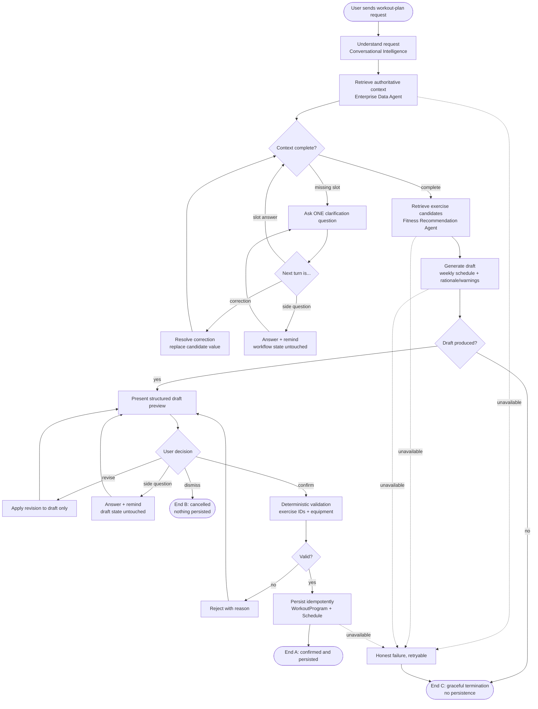
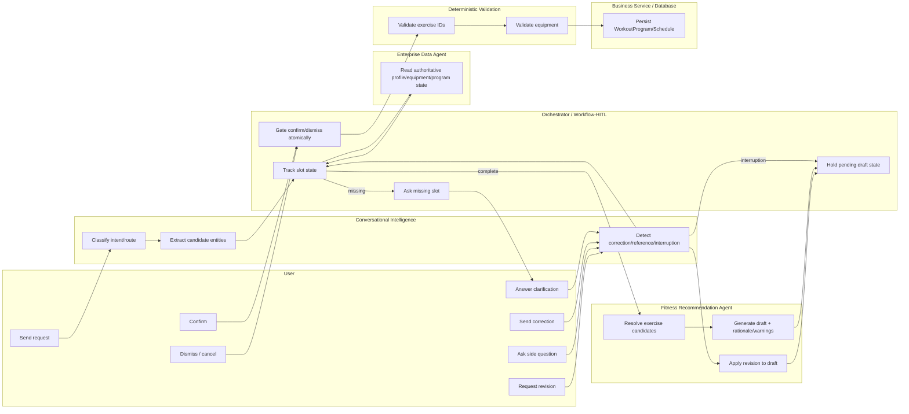

# 03 — TO-BE Business Process Model

This is the intended research BPM. It is close to the AS-IS process (`02-as-is-process.md`) because the existing
implementation already embodies most of the right architecture — the TO-BE model's job is to make every step,
gateway, and exception path **explicit and named**, and to flag the few places (equipment-at-draft-time; see
`12-gap-analysis-and-next-implementation.md`) where AS-IS and TO-BE genuinely differ, rather than reverse-engineer
the BPM to match whatever the code already does.

## 1. BPMN-style textual specification

| # | Element | Type | Description |
|---|---|---|---|
| 1 | Start Event | Start | Authenticated user sends a natural-language workout-plan request |
| 2 | Understand Request | Service Task | Conversational Intelligence classifies intent/route, extracts candidate entities (FR01, FR02) |
| 3 | Retrieve Authoritative Context | Service Task | Enterprise Data Agent reads profile, equipment, existing program/workflow state (FR03) |
| 4 | Context Complete? | Exclusive Gateway | Are `daysPerWeek`/`sessionMinutes` (and any other required slot) resolvable from context? |
| 5 | Ask Clarification | User Task | System asks exactly one missing slot; waits for the user (FR06) |
| 6 | Correction Received? | Exclusive Gateway | Does the next user turn contradict/replace an already-known value? (FR05) |
| 7 | Knowledge-Question Interruption? | Exclusive Gateway | Is the next turn a side question unrelated to the pending slot? (EX09) |
| 7a | Answer + Remind | Service Task | Answer the question from authoritative data; remind the user how to continue; workflow state untouched |
| 8 | Retrieve Exercise Candidates | Service Task | Fitness Recommendation Agent + Enterprise Data Agent resolve canonical exercises for the goal/constraints (FR10) |
| 9 | Generate Draft | Service Task | Fitness Recommendation Agent produces a weekly schedule draft + rationale/warnings (FR11) |
| 10 | Draft Produced? | Exclusive Gateway | Did generation yield at least one valid day? |
| 11 | Graceful Termination (No Draft) | End Event (C) | Nothing to show; user told honestly, invited to retry/rephrase |
| 12 | Present Draft | Service Task | Structured preview + rationale + warnings shown to the user (FR12) |
| 13 | User Decision | Exclusive Gateway | Revise, confirm, dismiss, or (side) interrupt |
| 13a | Apply Revision | Service Task | Revise the draft in place; context/exclusions preserved; loop back to 12 (FR13, FR14) |
| 13b | Interruption During Review | (same as 7a) | Draft/workflow state untouched; resumes to 12/13 |
| 14 | Dismiss | User Task | Explicit "Bỏ qua" / cancel; draft marked `CANCELLED`, nothing persisted |
| 15 | End Event (B) | End | Cancelled — nothing persisted |
| 16 | Confirm | User Task | Explicit confirmation through the dedicated confirm action (never free text) (FR16) |
| 17 | Deterministic Validation | Service Task | Exercise-ID + equipment validation against authoritative catalog/user equipment (FR17) |
| 18 | Valid? | Exclusive Gateway | Does the draft pass deterministic validation? |
| 19 | Reject With Reason | Service Task | Draft stays `PENDING`/unexecuted; user told exactly what failed; loop back to 12/13a |
| 20 | Persist | Service Task | Business Service writes `WorkoutProgram`/days/exercises/schedule, idempotently keyed (FR18, FR19) |
| 21 | End Event (A) | End | Confirmed and persisted |
| — | Downstream Unavailable | Error/Exception path | Any service-task step (3, 8, 9, 17, 20) that cannot complete routes to an honest, retryable failure response, never a fabricated success (EX07, EX08, EX16) |

No parallel gateway is used: every step in this BPM is a genuine sequential dependency (you cannot validate a draft
that doesn't exist yet, cannot persist before confirmation, etc.) — adding one would not reflect anything the real
process actually does concurrently, so none is modeled, per the brief's own instruction not to add gateways just
for appearance.

## 2. Mermaid diagram

## 3. Swimlane representation

## Legend

- **User Task**: requires a real user turn (cannot be automated away).
- **Service Task**: performed entirely by the system.
- **Exclusive Gateway**: exactly one outgoing path is taken.
- Dashed edges in the first diagram mark the error/exception path shared by every service task that depends on an
  external call.
